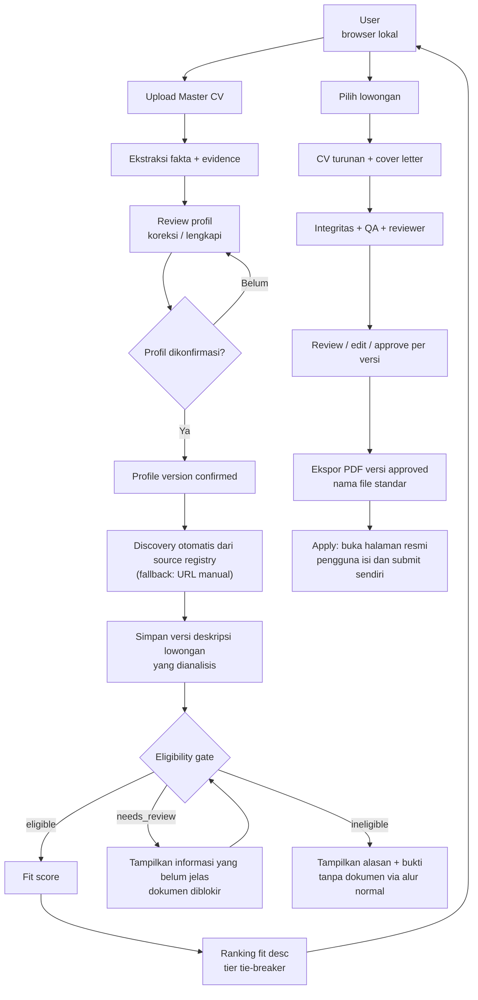
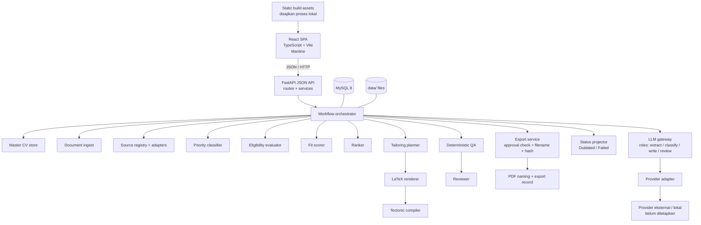
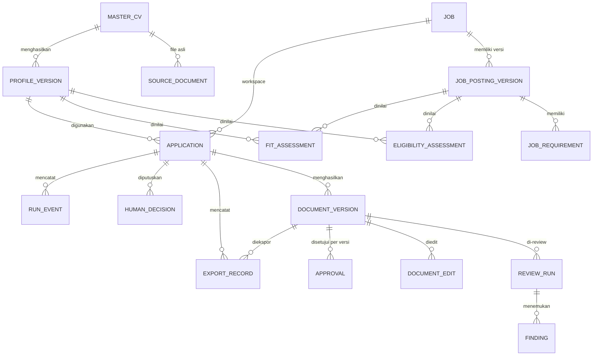

# Gawe — Rencana Arsitektur dan Implementasi

**Status:** Draft revisi untuk review. Belum ada implementasi.
**Tanggal:** 27 Oktober 2026
**Revisi:** 10 — urutan prioritas sumber discovery ditetapkan (API resmi, lalu URL manual, lalu jalur browser/ekstensi sebagai opsi terakhir); API agregator resmi disiapkan sebagai desain dengan syarat D27, tanpa adapter dan tanpa perubahan `ACCESS_METHODS`.
**Direktori proyek:** `D:\gawe`
**Effort:** High

> Dokumen ini adalah satu-satunya artefak yang dibuat pada tahap perencanaan. Tidak ada source code, scaffold, dependency, database, atau konfigurasi proyek yang dibuat. Implementasi menunggu persetujuan eksplisit. Persetujuan atas revisi rencana ini bukan persetujuan implementasi.

**Catatan perubahan:**

- **Revisi 10 (27 Oktober 2026):** Urutan prioritas sumber discovery ditetapkan (D26). API resmi menjadi target utama: ATS per perusahaan lebih dulu, lalu API agregator resmi. URL manual menjadi jalur kedua. Jalur `browser` dan ekstensi browser dipertahankan tetapi turun menjadi opsional dan prioritas terakhir; syarat keamanan D23 tidak dilonggarkan. API agregator resmi disiapkan sebagai desain dengan syarat D27 (dokumentasi API resmi, `tos_notes`, kuota harian, key dari keyring/environment, `snippet_only` wajib `needs_review`, `apply_url` ke halaman asli). Tidak ada adapter agregator yang dibangun, tidak ada migrasi, dan `ACCESS_METHODS` tetap `{ats_api}`. Pita `priority_order` (10-29 API, 30-69 agregator non-API, 900+ manual/ekstensi) adalah konvensi, bukan constraint. Dedupe memilih baris kanonik menurut band sumber; baris lama tidak di-backfill. Perbandingan kandidat agregator ada di [`docs/notes/aggregator-shortlist.md`](docs/notes/aggregator-shortlist.md). Tidak ada perubahan pada aturan Master CV, eligibility-before-fit, approval, ekspor, atau larangan auto-submit.
- **Revisi 9 (19 Oktober 2026):** Arah discovery diubah atas arahan pengguna. Discovery otomatis dari source registry menjadi jalur utama dan masuk Phase 3 (milestone 3A discovery, 3B normalisasi/dedupe, 3C eligibility/matching, 3D UI dan dokumen). URL manual menjadi fallback opsional. Phase 4 menjadi perluasan sumber terverifikasi dan skala discovery. D3 kini memblokir aktivasi sumber dan acceptance discovery Phase 3; D17 memblokir klaim cakupan Indonesia. Acceptance lama dipertahankan dan ditambah kriteria per milestone. Tidak ada perubahan pada aturan Master CV, eligibility-before-fit, approval, ekspor, atau larangan auto-submit.
- **Revisi 8 (19 Oktober 2026):** Sinkronisasi status D1 dengan [`docs/source-of-truth/DECISIONS.md`](docs/source-of-truth/DECISIONS.md). D1 **Diputuskan** 2026-10-19: 9Router sebagai satu provider aktif lewat adapter `openai_compatible`; `base_url` dan model per role tetap konfigurasi; API key lewat `api_key_ref` atau environment development; fake provider dipertahankan. Consent cloud dan D18 detail provider tetap berlaku. Tidak ada keputusan, kontrak konfigurasi, schema, atau OpenAPI yang diubah. Catatan status D1 pada Revisi 6 dan Revisi 7 bersifat historis.
- **Revisi 7 (19 Oktober 2026):** Konsistensi D1 dan timing provider: fake provider cukup untuk Phase 1; provider nyata wajib dipilih sebelum Phase 2 dinyatakan berfungsi penuh; tanpa pilihan itu Phase 2 dibatasi pada fondasi/fake provider. Gate D3/D17 dipindahkan ke Phase 4 dan tidak memblokir Phase 1–3 atau Master CV. Privasi/retensi diselaraskan: log operasional tanpa isi CV/CL/PII; debug model I/O mati secara default; retensi berlabel sementara sampai D10 disetujui. MVP dibedakan menjadi MVP inti Phase 1–3 dan MVP discovery Phase 1–4. Status D1, D3, D10, dan D17 tetap terbuka. *(Catatan historis: posisi D3/D17 diubah lagi pada Revisi 9.)*
- **Revisi 6 (19 Oktober 2026):** D22 ditetapkan selesai/diputuskan. **Mantine** menjadi library komponen UI resmi Gawe. React + TypeScript + Vite tetap. Komponen dan styling bawaan Mantine dipakai semaksimal mungkin. CSS manual hanya pengecualian minimal yang terdokumentasi. Tidak ada pencampuran beberapa library komponen UI utama. Keputusan terbuka lain (D1, D3, D6, D17, D20, D21) tidak diubah.
- **Revisi 5:** finalisasi stack frontend React + TypeScript + Vite, library komponen UI, dan penyesuaian arsitektur, struktur repo, fase, risiko, serta acceptance criteria.

---

## Daftar Isi

1. [Executive Summary](#1-executive-summary)
2. [Fakta, Asumsi, dan Keputusan](#2-fakta-asumsi-dan-keputusan)
3. [End-to-End Workflow](#3-end-to-end-workflow)
4. [Detail Perilaku Tiga Workflow](#4-detail-perilaku-tiga-workflow)
5. [Diagram Alur](#5-diagram-alur)
6. [Arsitektur Komponen dan Agent](#6-arsitektur-komponen-dan-agent)
7. [Reviewer dan Quality Gates](#7-reviewer-dan-quality-gates)
8. [Rekomendasi Technical Stack](#8-rekomendasi-technical-stack)
9. [Data Model dan Strategi Penyimpanan](#9-data-model-dan-strategi-penyimpanan)
10. [Strategi Graphify](#10-strategi-graphify)
11. [Security dan Reliability](#11-security-dan-reliability)
12. [Proposed Repository Structure](#12-proposed-repository-structure)
13. [Roadmap Implementasi](#13-roadmap-implementasi)
14. [Kriteria Penerimaan MVP Inti dan MVP Discovery](#14-kriteria-penerimaan-mvp-inti-dan-mvp-discovery)
15. [Risiko, Trade-off, dan Pertanyaan](#15-risiko-trade-off-dan-pertanyaan)
16. [Rekomendasi Akhir](#16-rekomendasi-akhir)

---

## 1. Executive Summary

**Rekomendasi inti:** bangun **Gawe sebagai aplikasi web lokal untuk satu pengguna**, dengan backend Python, frontend **React + TypeScript + Vite** dengan **Mantine** sebagai satu-satunya library komponen UI utama, pipeline deterministik, dan LLM hanya di titik yang membutuhkan penalaran bahasa. LLM diakses melalui lapisan adapter yang provider-agnostic; provider dan model belum ditetapkan dan harus dapat diganti lewat konfigurasi.

**Prinsip inti arsitektur dan produk:**

```text
Master CV (immutable)
  → ekstraksi fakta + evidence
  → review & koreksi pengguna
  → verified candidate profile (versi confirmed)
  → discovery otomatis dari source registry (fallback: URL manual)
  → versi deskripsi lowongan yang dianalisis
  → eligibility gate
  → fit score (hanya untuk eligible)
  → CV turunan + cover letter per lowongan
  → review, edit, approve per versi
  → ekspor PDF versi approved
  → Apply membuka halaman resmi; pengguna submit sendiri
```

Alasan:

1. **Satu sumber fakta.** Master CV adalah sumber utama. Dokumen yang dikirim ke perusahaan adalah turunan yang disesuaikan, bukan Master CV yang diedit ulang. Tailoring tidak pernah menimpa file asli.
2. **Profil harus disetujui sebelum pencarian.** Scraping tidak dimulai otomatis setelah upload. Pengguna meninjau hasil ekstraksi, mengoreksi, lalu mengonfirmasi. Versi profil yang disetujui menjadi konteks pencarian dan scoring.
3. **False positive lebih mahal daripada false negative.** Pengguna membuang waktu pada lamaran yang jelas tidak layak. Karena itu eligibility dievaluasi terpisah, dengan status `eligible`, `ineligible`, atau `needs_review`, bukan disamarkan menjadi angka.
4. **Fit score adalah dasar ranking.** Lowongan diurutkan dari fit tertinggi. Priority tier hanya tie-breaker saat skor sama atau sangat berdekatan, dengan aturan eksplisit.
5. **Integritas dokumen lebih penting daripada kreativitas.** Setiap klaim penting di CV turunan harus dapat ditelusuri ke fakta Master CV atau deklarasi pengguna yang eksplisit.
6. **Reviewer harus terisolasi.** Instruksi dan konteks reviewer dipisahkan dari proses penulisan. Model berbeda dianjurkan bila tersedia, tetapi pemilihan model tetap konfigurasi.
7. **Sumber lowongan harus jujur.** Discovery otomatis dari source registry adalah jalur utama. Seed awal sekitar 20 perusahaan Indonesia dan global adalah target, bukan cakupan terverifikasi. URL manual hanya fallback opsional saat sumber tidak tersedia atau gagal.
8. **Graphify adalah fondasi pengembangan.** Dipakai untuk pemetaan konteks, dependensi, dan struktur kode. Bukan database runtime.
9. **Apply adalah tindakan manusia.** Gawe membuka halaman lamaran resmi yang terverifikasi. Pengguna mengisi formulir, mengunggah dokumen, dan menekan submit. Tidak ada auto-submit, auto-email, atau klaim bahwa lamaran sudah terkirim.
10. **Approval melekat pada versi dokumen.** Persetujuan hanya berlaku untuk versi CV atau cover letter yang disetujui. Edit atau regenerate membuat versi baru yang belum disetujui.
11. **Frontend memakai React + TypeScript + Vite dengan Mantine.** UI adalah SPA yang memanggil API JSON backend. Tidak ada template HTML server-side sebagai UI utama. Komponen dan styling berasal dari Mantine (theme + props); CSS manual hanya pengecualian minimal yang terdokumentasi.

**Target pasar:** Indonesia dan global.

**Priority tier** — atribut terpisah, bukan dasar ranking:

| Tier | Kategori | Arti operasional |
|---|---|---|
| P1 | Global — onsite | Peran di luar Indonesia yang membutuhkan kehadiran fisik di luar Indonesia (onsite/hybrid). |
| P2 | Global — remote | Remote yang secara eksplisit menerima kandidat dari Indonesia atau kandidat worldwide. |
| P3 | Indonesia — remote | Peran berbasis Indonesia; sepenuhnya remote. |
| P4 | Indonesia — onsite | Peran berbasis Indonesia; onsite/hybrid. |
| `unclassified` | Metadata tidak cukup | Tidak ditebak; ditampilkan dengan alasan. |

**Urutan ranking default:** `fit_score` menurun. Tie-breaker hanya berlaku saat skor sama atau berada dalam `tie_window` yang dikonfigurasi eksplisit (default 0 = skor identik): tier P1 → P4, lalu `posted_at` terbaru, lalu `job_id` stabil. Lowongan P1 dengan fit rendah tidak boleh mengalahkan P2 dengan fit tinggi.

**MVP inti (Phase 1–3):** workflow dari discovery otomatis sampai ekspor. Hasilnya: Master CV terunggah, profil terkonfirmasi, lowongan ditemukan dari source registry (fallback URL manual), dinilai eligibility dan fit-nya, serta CV turunan + cover letter yang disetujui per versi, PDF bernama standar, dan laporan review. Tombol Apply membuka halaman resmi perusahaan; pengguna yang mengirim lamaran. MVP inti membutuhkan daftar seed (D3); klaim cakupan Indonesia membutuhkan D17.

**MVP discovery (Phase 1–4):** MVP inti ditambah perluasan sumber terverifikasi (termasuk sumber Indonesia), adapter tambahan, dan skala tampilan Job Matches. Acceptance cakupan Indonesia hanya terpenuhi setelah D17 tersedia dan sumber diverifikasi.

**Yang tidak dibangun:** deployment publik, server cloud, multi-user, autentikasi multi-user, auto-submit lamaran, OCR v1, vector database, Docker, microservice, queue eksternal, scraping portal ber-CAPTCHA, template HTML server-side sebagai UI, pencampuran beberapa library komponen UI utama, dan framework agent otonom.

---

## 2. Fakta, Asumsi, dan Keputusan

### 2.1 Fakta yang sudah diverifikasi

| Item | Status | Bukti |
|---|---|---|
| `D:\gawe` kosong | Terverifikasi | Directory listing kosong |
| Windows 11, AMD64 | Terverifikasi | `10.0.26200` |
| Python 3.11.8, Node 24.19.0, uv 0.12.23, git | Terverifikasi | Command probe |
| LaTeX, Tectonic, pandoc | Tidak terpasang | Command probe |
| Graphify 0.9.80 | Terpasang | `graphify --version` |
| Graphify mendukung AST Python/TS/JS/Go/Rust/Java dll. | Terverifikasi | Daftar `CODE_EXTENSIONS` di paket |
| Greenhouse Job Board API | Publik, tanpa auth untuk GET | `boards-api.greenhouse.io` |
| Lever Postings API | Publik, `mode=json`, pagination | `api.lever.co/v0/postings` |
| Ashby Job Posting API | Publik, tanpa auth | `api.ashbyhq.com/posting-api/job-board` |
| Arbeitnow API | 200, JSON board penuh (~2 MB) | Probe langsung |
| Remotive API | 200; attribution; maks. ~4 request/hari; data delay 24 jam | Legal notice di response |
| Jobicy API | 200; attribution; redirect ke URL asli | `friendlyNotice` |
| RemoteOK API | 200; link-back attribution | Field `legal` |
| Tectonic 0.17.0 | MIT; Windows single executable; auto-download paket | Dokumentasi resmi |
| PyMuPDF | AGPL atau komersial | Dokumentasi resmi |
| MarkItDown | MIT; PDF/DOCX; Python 3.10–3.14 | Repo resmi |
| MySQL 8.0.30 (Laragon) | Terverifikasi, `127.0.0.1:3306` | `SELECT VERSION()` |
| OpenCode custom command | `.opencode/commands/*.md`, `$ARGUMENTS`, shell injection | Dokumentasi OpenCode; hanya referensi, bukan UI utama |

**Catatan:** tidak ada verifikasi bahwa API lowongan Indonesia tertentu tersedia, stabil, atau mengizinkan penggunaan otomatis. Daftar sumber di §4.2 membedakan yang sudah diprobe dari yang belum.

### 2.2 Keputusan yang sudah diambil

| ID | Keputusan | Konsekuensi |
|---|---|---|
| K1 | Pasar: Indonesia dan global. | Discovery, preferensi, klasifikasi, dan rekomendasi mencakup kedua pasar. |
| K2 | Priority tier: P1 global onsite, P2 global remote, P3 Indonesia remote, P4 Indonesia onsite. | Tier adalah atribut dan tie-breaker, bukan filter dan bukan komponen fit score. |
| K3 | Provider/model LLM: D1 diputuskan — 9Router lewat adapter `openai_compatible`; model per role tetap konfigurasi. | Arsitektur provider-agnostic; provider diganti lewat konfigurasi. |
| K4 | Interface: web lokal untuk satu pengguna; frontend React + TypeScript + Vite, backend API JSON. | Tidak ada asumsi deployment publik, server cloud, atau multi-user. Tidak ada template HTML server-side sebagai UI utama. |
| K5 | Kandidat mengunggah CV sebagai sumber profil. | Tidak ada scraping profil dari LinkedIn atau sumber eksternal. |
| K6 | Graphify adalah fondasi pemetaan konteks, kode, dan dependensi. | Dipakai saat pengembangan, bukan database runtime aplikasi. |
| K7 | Human-in-the-loop; tidak ada auto-submit. | Semua gate review dipertahankan. |
| K8 | Master CV immutable; dokumen lamaran adalah turunan per lowongan. | Tailoring tidak pernah menimpa Master CV atau dokumen lowongan lain. |
| K9 | Profil hasil ekstraksi wajib direview dan dikonfirmasi sebelum scraping. | Tidak ada alur upload → scraping otomatis. |
| K10 | `fit_score` adalah dasar ranking; priority tier hanya tie-breaker. | Urutan tidak boleh didominasi tier. |
| K11 | Eligibility gate terpisah dari `fit_score`. | Skor tinggi tidak menyiratkan kandidat memenuhi syarat wajib. |
| K12 | Seed awal sekitar 20 perusahaan Indonesia dan global, dikelola lewat web UI. | Target awal, bukan cakupan terverifikasi; daftar dapat ditambah/diedit/dinonaktifkan. |
| K13 | Format CV: maksimal 2 halaman, satu kolom, ATS-friendly, tanpa foto default. | Lihat D5. |
| K14 | Instalasi Tectonic dan dependensi belum diputuskan; keputusan diambil saat Phase 3. | Tidak ada instalasi pada tahap perencanaan. Lihat D6. |
| K15 | Sebelum data kandidat dikirim ke provider cloud, pengguna diberi penjelasan dan diminta persetujuan. | Consent gate dan minimisasi data wajib. |
| K16 | Bahasa CV dan cover letter mengikuti bahasa lowongan bila memungkinkan. | Lihat D19. |
| K17 | Relokasi dan work authorization ditanyakan saat setup profil. | Kelayakan lokasi dapat dinilai; ketidakpastian menjadi `needs_review`. |
| K18 | Hybrid diklasifikasikan sebagai onsite untuk priority tier. | Hybrid tidak disebut remote penuh. |
| K19 | Apply membuka halaman lamaran resmi; pengguna mengisi dan submit sendiri. | Tidak ada auto-submit, auto-email, atau klaim lamaran terkirim. URL dari data sumber terverifikasi atau URL manual tervalidasi; tidak dikarang. |
| K20 | Approval terikat pada versi dokumen spesifik dan independen antara CV dan cover letter. | Edit/regenerate membuat versi baru yang belum disetujui; ekspor hanya dari versi approved. |
| K21 | Status proses, status dokumen, dan status aplikasi dibedakan; `Outdated` berbeda dari `Failed`. | UI memakai istilah status yang konsisten dan tidak mencampur status. |
| K22 | Nama file PDF memakai format `CV_<Candidate>_<Company>_<Position>.pdf` dan `Cover_Letter_<Candidate>_<Company>_<Position>.pdf`. | Nama file disanitasi, dapat diedit sebelum ekspor, dan tidak mengubah isi atau approval. |
| K23 | Fit score dihitung hanya setelah eligibility berstatus `eligible`. | `needs_review` dan `ineligible` tidak masuk ranking fit utama. |
| K24 | Frontend: React + TypeScript + Vite + Mantine, dibangun sebagai SPA lokal. | Backend menjadi API JSON; tidak ada Jinja2/HTMX sebagai UI utama; Mantine adalah satu-satunya library komponen UI utama. |
| K25 | UI memakai Mantine dengan komponen dan styling bawaan; TypeScript bahasa utama frontend. | CSS manual diminimalkan dan hanya sebagai pengecualian terdokumentasi; JSX adalah lapisan render, bukan template HTML yang dipelihara terpisah; tidak mencampur library komponen UI utama lain. |
| K26 | Backend Python tetap sumber kebenaran untuk workflow, validasi, dan persistensi. | Frontend tidak menghitung ulang eligibility, fit score, approval, atau status. |

### 2.3 Asumsi

| ID | Asumsi | Dampak bila salah |
|---|---|---|
| A1 | Graphify yang dimaksud adalah CLI `graphify` 0.9.80 yang terpasang. | Integrasi harus diubah. |
| A2 | Master CV utama berbasis teks (bukan scan). | Perlu OCR lebih awal. |
| A3 | Kandidat bersedia mengisi kesediaan relokasi dan work authorization saat setup. | Eligibility lokasi menjadi `needs_review` untuk sebagian besar lowongan global. |
| A4 | Kandidat bersedia mengirim teks CV dan job description ke provider LLM yang dikonfigurasi, setelah consent. | Harus memakai pemrosesan lokal atau membatasi fitur. |
| A5 | Satu pengguna, satu proses aplikasi pada satu waktu. | Perlu locking dan model data multi-user. |
| A6 | Instalasi Tectonic dapat diputuskan saat Phase 3. | Perlu MiKTeX/TeX Live atau format PDF lain. |
| A7 | Lowongan yang diproses lewat `/apply` adalah URL publik. | Perlu input teks manual. |
| A8 | Review manusia tetap dilakukan sebelum submit. | Risiko lamaran salah naik. |
| A9 | Browser modern tersedia di mesin lokal. | Perlu fallback tampilan minimal. |
| A10 | Metadata lokasi dan mode kerja sebagian lowongan tidak lengkap. | Sebagian job masuk `unclassified` atau `needs_review`. |
| A11 | Daftar 20 perusahaan seed akan diisi pengguna; belum ada daftar final. | Discovery awal kosong atau tidak relevan. |
| A12 | Sebagian sumber Indonesia membatasi akses otomatis. | Cakupan Indonesia bergantung pada verifikasi sumber (D17) dan fallback URL manual. |
| A13 | PDF dan DOCX adalah format Master CV yang direncanakan; parser perlu diuji pada dokumen nyata. | Format lain harus dikonversi pengguna. |

### 2.4 Rekomendasi (bukan fakta)

- Python + FastAPI + MySQL 8 + Tectonic (bila disetujui saat Phase 3) + React + TypeScript + Vite + Mantine.
- Web server lokal di `127.0.0.1`, tanpa deployment publik.
- Satu provider LLM aktif per konfigurasi; role boleh menunjuk model berbeda. Provider kedua opsional, bukan kebutuhan v1.
- Empat peran: `extract`, `classify`, `write`, `review`.
- Reviewer memakai instruksi/konteks terpisah; model berbeda bila tersedia.
- V1 tanpa browser automation.
- Graphify dijalankan per fase, bukan saat runtime.
- Eligibility deterministik dulu; LLM hanya untuk requirement yang ambigu, dengan kutipan.

### 2.5 Keputusan yang masih terbuka

Dirinci di [§15.4](#154-pertanyaan-yang-perlu-diputuskan). Gate keputusan mengikuti fase yang membutuhkannya:

- **Phase 1:** hanya membutuhkan D22 (sudah diputuskan) dan kontrak adapter. Fake provider dipakai untuk menguji kontrak; tidak ada provider nyata yang diasumsikan.
- **Phase 2 penuh:** membutuhkan provider aktif (D1 sudah diputuskan: 9Router lewat `openai_compatible`) dan consent. Tanpa konfigurasi provider, Phase 2 berhenti pada fondasi, ingest, schema, UI review, dan fake provider. Phase 2 tetap menunggu persetujuan eksplisit.
- **Phase 3:** D1 sudah diputuskan; D3 (daftar seed) dibutuhkan agar sumber dapat diaktifkan dan acceptance discovery diklaim; D6 dibutuhkan saat instalasi Tectonic dimulai, dan D21 sebelum override `ineligible` diimplementasikan. D17 dibutuhkan untuk klaim cakupan Indonesia.
- **Phase 4:** perluasan sumber terverifikasi, termasuk sumber Indonesia setelah D17 tersedia.

D10 (retensi) belum disetujui; semua durasi retensi di dokumen ini bersifat sementara. D20 (autentikasi lokal) tidak memblokir implementasi. Library komponen UI sudah ditetapkan (D22: **Mantine**). D1 sudah diputuskan (9Router); consent cloud tetap prasyarat sebelum pengiriman data kandidat pertama.

### 2.6 Konflik yang belum terselesaikan

| Konflik | Status | Dampak sementara |
|---|---|---|
| Fit score vs priority tier | **Diselesaikan** oleh K10: fit utama, tier tie-breaker. | Aturan tie-break harus diuji. |
| P1 global onsite vs izin kerja | **Sebagian diselesaikan** oleh K17: pertanyaan setup + `needs_review`. | Kualitas jawaban pengguna menentukan hasil. |
| Cakupan Indonesia vs sumber ATS | **Terbuka**: belum ada sumber Indonesia terverifikasi. | Discovery otomatis berjalan untuk sumber terverifikasi; cakupan Indonesia menunggu D17; URL manual sebagai fallback. |
| Global remote: label vs eligibility | **Diselesaikan** oleh aturan D16 di §4.2. | Metadata buruk menghasilkan `needs_review`. |
| Provider-agnostic vs fitur native | **Diselesaikan sebagian**: kontrak minimal + validasi deterministik. | Fitur native tidak boleh menjadi ketergantungan. |
| Web lokal tanpa auth vs keamanan | **Terbuka**: keputusan D20. | Bind localhost + CSRF untuk v1. |
| Master CV berubah setelah lamaran dibuat | **Diselesaikan** oleh versioning: dokumen lama tidak ditimpa. | Perlu UI untuk regenerate. |
| Override `ineligible` vs eligibility gate | **Sebagian diselesaikan**: bukan default; hanya pengecualian eksplisit dengan peringatan dan alasan tercatat. | Keputusan produk D21 masih terbuka. |
| Status aplikasi vs status dokumen | **Diselesaikan** oleh K20/K21: status dokumen adalah sumber kebenaran; status aplikasi hanya ringkasan. | UI harus konsisten di semua halaman. |
| Approval lama vs versi baru | **Diselesaikan** oleh K20: approval tidak berlaku untuk versi berikutnya. | Ekspor harus memeriksa ID/hash versi. |
| Server-rendered vs SPA | **Diselesaikan** oleh K24: React + TypeScript + Vite SPA, backend API JSON. | Tidak ada template HTML server-side sebagai UI utama. |
| "Tanpa HTML/CSS manual" vs kebutuhan tampilan khusus | **Diselesaikan** oleh D22: Mantine adalah satu-satunya library komponen UI utama; CSS kustom hanya pengecualian minimal terdokumentasi. | Aturan Mantine-first dan pengecualian CSS harus ditinjau saat review. |
| Graphify untuk konteks proyek vs data runtime | **Diselesaikan**: Graphify bukan runtime store. | MySQL 8/files tetap runtime store. |
| Versi Python terpasang vs target stack | **Terbuka**: mesin memiliki Python 3.11.8; §8 menyarankan 3.12. | Pakai versi yang tersedia atau pasang 3.12 lewat uv; verifikasi dependency sebelum Phase 1. |

---

## 3. End-to-End Workflow



**Gate manusia:**

1. **Profil:** scraping tidak berjalan sebelum profil dikonfirmasi. Versi profil dicatat.
2. **Lowongan:** pengguna meninjau eligibility, fit score, alasan, dan gap sebelum memilih. `needs_review` harus diselesaikan sebelum dokumen dibuat; `ineligible` tidak masuk alur dokumen normal.
3. **Dokumen:** pengguna membandingkan CV turunan dengan Master CV, mengedit, meminta revisi, dan menyetujui versi tertentu.
4. **Final:** ekspor hanya dari versi yang disetujui. Tombol Apply membuka halaman resmi perusahaan; tidak ada auto-submit atau auto-email.

**Artefak per tahap:**

| Tahap | Input | Output | Gate |
|---|---|---|---|
| `/setup` | Master CV (PDF/DOCX/TXT/MD) + jawaban work preference | Master CV record, ekstraksi, profil draft, versi confirmed | Konfirmasi user |
| `/scrape` | Profil confirmed + source registry + preferensi | Job + versi deskripsi + eligibility + fit score (eligible) + ranking | User pilih job |
| `/apply` | URL atau `job_id` + profil confirmed | Versi deskripsi dianalisis, eligibility, fit assessment, CV/CL versions, findings, approval per versi, PDF + metadata ekspor | Eligibility gate + review + approve per versi; Apply manual |

Nama `/setup`, `/scrape`, dan `/apply` dipertahankan sebagai **nama workflow internal** dan label UI. Antarmuka utama adalah halaman web, bukan slash command OpenCode.

---

## 4. Detail Perilaku Tiga Workflow

### 4.0 Interface web lokal dan spesifikasi UI

Produk tetap **aplikasi web lokal single-user**. UI berorientasi workflow, ringkas, dan informatif. UI bukan dashboard dekoratif.

#### A0. Stack frontend

- **React + TypeScript + Vite** sebagai frontend utama. TypeScript adalah bahasa utama kode frontend.
- React merender UI menjadi HTML di browser. Larangan "HTML manual" berarti tidak ada template HTML server-side (Jinja2/HTMX) yang dibuat atau dipelihara sebagai pendekatan UI utama; JSX adalah lapisan render.
- Backend Python mengekspos **API JSON**. Frontend tidak mengakses MySQL atau filesystem langsung.
- **Mantine** dipakai sebagai satu-satunya library komponen UI utama untuk layout, navigasi, tabel, form, dialog, badge status, notifikasi, dan state kosong/error. Keputusan ini final (D22).
- CSS manual hanya untuk pengecualian yang tidak dicakup Mantine, dan dicatat sebagai `shortcut:` atau ADR kecil. Tidak ada stylesheet aplikasi yang tumbuh sebagai lapisan styling utama. Tidak mencampur library komponen UI utama lain.
- Routing direkomendasikan memakai React Router. Pengambilan data dan cache direkomendasikan memakai TanStack Query. Mantine menangani presentasi, bukan routing atau data fetching.
- Tidak ada Jinja2 atau HTMX sebagai frontend utama. Tidak ada render HTML server-side untuk halaman aplikasi.
- Tipe data frontend dihasilkan atau diselaraskan dari skema API backend agar kontrak tidak ditulis dua kali secara manual.
- Semua perhitungan bisnis (eligibility, fit score, ranking, approval, status, penamaan file) tetap di backend. Frontend hanya menampilkan dan mengirim aksi.
- Build produksi berupa aset statis yang disajikan proses lokal yang sama dengan API. Saat pengembangan, Vite dev server mem-proxy API ke backend lokal. Tidak ada server frontend terpisah di produksi.

#### A. Gaya dan navigasi

- Gaya minimal, fokus pada pekerjaan, dengan kepadatan informasi yang cukup. Navigasi utama di bagian atas. Halaman utama:
  1. **Overview** — `/`
  2. **Master CV** — `/master-cv`
  3. **Find Jobs / Discovery** — `/discovery`
  4. **Job Matches** — `/matches`
  5. **Applications** — `/applications`
  6. **Settings** — `/settings`
- Istilah status dipakai konsisten di seluruh halaman.
- Status tidak boleh dibedakan hanya berdasarkan warna; gunakan teks atau ikon yang bermakna.
- Setiap halaman menyediakan loading, empty state, error state, partial success, dan retry state.
- Tidak ada grafik atau kartu dekoratif tanpa fungsi operasional.
- Satu proses aplikasi lokal di `127.0.0.1` pada produksi: backend menyajikan API dan aset frontend hasil build. Saat pengembangan, Vite dev server berjalan terpisah di localhost dan mem-proxy API. State disimpan di MySQL 8 dan file; browser hanya view/control.
- Tugas panjang (fetch, parsing, generate, compile, ekspor) berjalan sebagai background task in-process dengan progress dan status. Tidak ada queue eksternal untuk v1.
- Tidak ada asumsi deployment publik, domain, TLS publik, atau multi-user.
- Tidak ada autentikasi multi-user. Keamanan bergantung pada bind localhost, akun OS, ACL direktori, dan CSRF token.
- Form yang mengubah state memakai CSRF token pada request API; konten job dirender sebagai teks oleh React. Jangan memakai `dangerouslySetInnerHTML` untuk konten lowongan; bila HTML perlu ditampilkan, sanitasi lebih dulu di backend atau dengan sanitizer.
- Status ditampilkan dengan komponen Mantine `Badge` berisi teks status, bukan warna saja.
- Tabel, drawer, tab, dialog, dan notifikasi memakai komponen Mantine, bukan elemen HTML mentah yang ditata manual.
- Workflow internal tetap dapat dipanggil lewat service layer untuk test, tetapi bukan CLI sebagai UX utama.
- Tombol **Start search** nonaktif sampai ada profil confirmed. Setelah profil baru dikonfirmasi, UI menawarkan **jalankan ulang pencarian**; hasil lama tetap tersimpan dengan `profile_version_id` lamanya.

**Pemetaan halaman ke komponen UI (konsep):**

| Halaman | Komponen utama |
|---|---|
| Overview | Layout, kartu ringkas non-dekoratif, badge status, daftar aktivitas |
| Master CV | Tab (Original CV / Verified Profile / History), upload, tabel field, dialog konfirmasi |
| Discovery | Form preferensi, daftar sumber dengan badge status, progress, alert per sumber, tombol retry |
| Job Matches | Tabel dengan search/sort/filter, drawer side panel, badge eligibility, komponen skor |
| Applications | Tabel workspace, drawer/tab dokumen, editor per bagian, diff viewer |
| Settings | Form bertipe, switch consent, daftar sumber, panel retensi |

Nama komponen konkret memakai Mantine (D22): `AppShell`, `Tabs`, `Table`, `Drawer`, `Modal`, `TextInput`, `Select`, `Badge`, `Alert`, `Notification`, dan `Skeleton`. Tabel ini menetapkan peran komponen, bukan nama API library.

#### B. Status workflow dan dokumen

Status proses aplikasi dibedakan dari status masing-masing dokumen. Gunakan istilah berikut sesuai konteks:

| Konteks | Status |
|---|---|
| Proses/run | `Not started`, `Processing`, `Needs review`, `Failed` |
| Dokumen | `Draft`, `In Review`, `Approved`, `Exported`, `Outdated`, `Failed` |
| Aplikasi (ringkasan) | `Not started`, `Processing`, `Needs review`, `In Review`, `Approved`, `Exported`, `Failed`, `Outdated` |

Aturan:

- `Outdated` tidak boleh dianggap sama dengan `Failed`. `Outdated` berarti sumber yang mendasari hasil berubah; `Failed` berarti proses gagal.
- `Ready for review` hanya berarti dokumen siap ditinjau, bukan sudah disetujui. Setelah disetujui, statusnya `Approved`.
- Status dokumen adalah sumber kebenaran. Status aplikasi hanya ringkasan; aplikasi tidak boleh berstatus `Approved` bila CV atau cover letter yang diwajibkan belum `Approved`.
- `Exported` hanya diberikan setelah file PDF berhasil dibuat dan tercatat pada versi yang disetujui.
- Perubahan sumber data—profil confirmed atau versi deskripsi lowongan—menandai analisis dan dokumen terkait sebagai `Outdated` bila relevan.
- Penandaan `Outdated` tidak otomatis menjalankan ulang analisis, membuat dokumen baru, atau menimpa versi lama. Pengguna memilih tindakan lanjutan secara eksplisit.
- Approval CV dan cover letter independen. Persetujuan salah satu tidak mengubah status yang lain.

#### C. Overview

Overview membantu pengguna melanjutkan pekerjaan:

- Status Master CV dan profil.
- Apakah profil sudah dikonfirmasi.
- Status discovery terakhir.
- Jumlah lowongan `eligible`, `ineligible`, dan `needs_review`.
- Dokumen yang menunggu review atau approval.
- Aktivitas terbaru dan tindakan berikutnya.

Jangan menampilkan persentase progress palsu bila total pekerjaan belum diketahui.

#### D. Master CV dan Profile

Tab: **Original CV**, **Verified Profile**, **History**.

- Pengguna mengunggah Master CV.
- Gawe mengekstrak fakta beserta evidence/locator.
- Pengguna dapat memeriksa, mengoreksi, dan mengonfirmasi profil.
- Scraping/discovery terkunci sebelum profil dikonfirmasi.
- Master CV asli immutable. Mengganti file Master CV tidak boleh diam-diam menimpa versi lama; upload baru membuat record baru.
- Setiap versi profil confirmed memiliki identitas yang jelas (`profile_version_id`).
- Tampilkan dampak perubahan profil terhadap analisis dan dokumen lama, termasuk penandaan `Outdated`.
- Perubahan profil tidak otomatis menjalankan ulang scraping atau menghasilkan dokumen baru.

#### E. Find Jobs / Discovery

Tampilkan:

- Profil confirmed yang digunakan dalam run.
- Sumber yang dipilih dan status verifikasinya.
- Progress yang benar-benar diketahui.
- Status per sumber: `Processing`, `Completed`, `Partial`, `Failed`, atau status ekuivalen yang jelas.
- Hasil parsial saat sumber lain masih diproses.
- Error per sumber dan tombol retry yang sesuai.
- Waktu fetch dan status verifikasi sumber.

Jangan menghapus hasil sukses ketika sumber lain gagal. Hindari duplikasi saat run diulang. Jangan menjanjikan cakupan sumber yang belum diverifikasi.

#### F. Job Matches

Gunakan tabel dengan **side detail panel**, bukan mewajibkan navigasi ke halaman detail terpisah.

Kolom minimum:

- Position
- Company
- Location / work mode
- Fit score
- Eligibility
- Priority tier sebagai informasi sekunder

Fitur:

- Search, sort, dan filter.
- Filter eligibility: all, eligible, ineligible, needs review.
- Sorting default berdasarkan fit score menurun.
- Priority tier hanya tie-breaker sesuai aturan ranking yang disepakati.
- Mengubah filter atau sort tidak mengubah fit score atau eligibility.
- `ineligible` ditampilkan terpisah dari ranking utama. `needs_review` ditampilkan di bagian terpisah dan tidak masuk ranking fit sampai status diselesaikan.

Side panel menampilkan:

- Deskripsi dan URL sumber.
- Waktu fetch serta versi deskripsi.
- Must-have dan nice-to-have requirements.
- Bukti kecocokan dan gap.
- Fit score dan komponen penilaiannya; untuk `needs_review` tampilkan bahwa fit belum dihitung.
- Eligibility dan alasan.
- Lokasi, remote/hybrid/onsite, work authorization, dan relokasi.
- Aksi yang sesuai dengan status eligibility.

Untuk `needs_review`, tampilkan tindakan untuk meninjau informasi yang belum jelas; jangan tampilkan aksi utama pembuatan dokumen sebelum status diselesaikan. Untuk `ineligible`, tampilkan alasan dan bukti, bukan tombol utama untuk membuat dokumen.

#### G. Application Workspace

Setiap lowongan mempunyai workspace sendiri yang terisolasi dari lowongan lain. Halaman **Applications** menampilkan daftar workspace; workspace dibuka per lowongan.

Tampilkan:

- Perusahaan, posisi, dan tautan lamaran resmi.
- Eligibility dan fit assessment yang dipakai.
- Versi profil serta versi job description yang menjadi dasar dokumen.
- CV dan cover letter secara terpisah.
- Versi dokumen, status review, approval, dan riwayat.
- Diff/perubahan dibandingkan sumbernya.
- Findings reviewer dan gap yang belum diselesaikan.
- Nama file PDF yang akan diekspor.
- Tombol edit, regenerate, compare, approve, export, dan Apply sesuai status.

Gunakan editor per bagian dan fitur review changes. Tidak perlu membuat editor dokumen kompleks atau live layout editor pada MVP.

Alur status dokumen: `Draft → In Review → Approved → Exported`. Ini alur status dokumen; status aplikasi secara keseluruhan boleh memiliki state tersendiri. Jika pengguna mengedit atau regenerate setelah approval, buat versi baru yang belum disetujui dan tampilkan bahwa versi baru belum disetujui.

Tombol **Apply** membuka halaman resmi perusahaan, bukan melakukan submit otomatis. Jika URL resmi terverifikasi tidak tersedia, tampilkan keterbatasan dan informasi yang tersedia; jangan mengarang URL.

#### H. Settings

Sediakan konfigurasi untuk:

- Provider dan model LLM yang dipilih.
- Peran LLM yang digunakan.
- Consent pengiriman data ke provider cloud.
- Preferensi pencarian dan work authorization.
- Source registry dan status verifikasi.
- Retensi data; durasi masih sementara sampai D10 disetujui.
- Toolchain dokumen.

Consent untuk mengirim data ke cloud terpisah dari konfirmasi profil dan persetujuan dokumen. Sebelum pengiriman cloud pertama, jelaskan data yang dikirim dan minta consent. Jangan mengklaim provider tidak menyimpan atau melatih model dengan data pengguna tanpa bukti.

### 4.1 `/setup` — Master CV dan Candidate Profile

#### Format input v1

| Format | Didukung | Parser | Catatan |
|---|---|---|---|
| PDF berbasis teks | Ya (direncanakan) | PyMuPDF | Simpan nomor halaman |
| DOCX | Ya (direncanakan) | python-docx | Simpan indeks paragraf/tabel |
| TXT / MD | Ya | stdlib | Locator baris |
| PDF scan/gambar | Tidak | — | Deteksi teks rendah, minta versi teks |
| DOC/RTF/ODT | Tidak | — | Minta konversi ke PDF/DOCX |
| PDF terenkripsi | Tidak | — | Tolak dengan pesan jelas |

Alasan: parser yang andal dan locator bukti. OCR ditunda sampai ada bukti bahwa dibutuhkan. Dukungan PDF/DOCX adalah rencana, bukan hasil verifikasi pada dokumen nyata.

#### Master CV record

Setiap upload menghasilkan record yang tidak pernah ditimpa:

```json
{
  "master_cv_id": "mcv_...",
  "original_file": {
    "sha256": "...",
    "filename": "cv.pdf",
    "mime": "application/pdf",
    "stored_path": "data/master_cv/<sha256>/original.pdf",
    "uploaded_at": "..."
  },
  "extraction_runs": ["ext_..."],
  "active_profile_version_id": "prf_...",
  "status": "uploaded | extracted | confirmed | superseded"
}
```

Aturan:

- File asli disimpan immutable dan content-addressed.
- Tailoring tidak pernah menulis ke `data/master_cv/`.
- Upload baru membuat Master CV record baru; versi lama tetap ada.
- Pengguna dapat menandai satu Master CV sebagai aktif.

#### Pipeline

1. **Validasi file:** ekstensi, MIME, magic bytes, ukuran ≤20 MB, PDF ≤50 halaman, cek zip bomb DOCX.
2. **Hash SHA-256.** Simpan salinan immutable di `data/master_cv/<sha256>/`.
3. **Ekstraksi teks + locator.** PDF: `p2:b14`. DOCX: `para:37` atau `table:2:row:4`.
4. **Normalisasi:** NFKC, whitespace, deteksi heading dan bullet. Deteksi bahasa.
5. **Ekstraksi LLM ber-schema.** Output: fakta + kutipan + locator. Panggilan memakai role `extract`, bukan model tertentu.
6. **Verifikasi bukti.** Kutipan harus ada di teks sumber setelah normalisasi. Gagal cocok → `unverified`, tidak masuk profil final tanpa konfirmasi.
7. **Validasi deterministik:** tanggal parseable, rentang tanggal tidak terbalik, email/telepon/URL regex, enum degree/proficiency.
8. **Coverage check:** bagian yang terdeteksi tetapi kosong masuk daftar "tidak jelas".
9. **Work preferences:** tampilkan form terpisah untuk kesediaan relokasi, work authorization, preferensi lokasi, dan mode kerja. Nilai dari CV hanya dipakai bila tertulis; sisanya deklarasi pengguna.
10. **Merge + conflict detection** terhadap profil aktif.
11. **Halaman review profil.** Setiap field dapat diedit, dilengkapi, atau dihapus. Setiap perubahan pengguna dicatat sebagai koreksi dengan sumber `user_correction`.
12. **Konfirmasi.** Profil baru berstatus `confirmed`; versi sebelumnya tetap tersimpan.
13. **Aktifkan versi.** Tulis audit log keputusan.

**Scraping tidak boleh dimulai pada langkah mana pun sebelum langkah 12 selesai.**

#### Field yang diekstrak

| Kategori | Contoh field | Sumber |
|---|---|---|
| Identitas profesional | Nama, email, telepon, lokasi, link | CV |
| Pendidikan | Institusi, gelar, bidang, tanggal | CV |
| Pengalaman | Perusahaan, jabatan, tanggal, bullet | CV |
| Proyek | Nama, peran, teknologi, hasil | CV |
| Skill/teknologi | Nama skill, konteks pemakaian | CV |
| Pencapaian | Metrik atau hasil yang tertulis | CV |
| Bahasa | Bahasa, level bila tertulis | CV |
| Sertifikasi | Nama, penerbit, tanggal | CV |
| Work authorization | Status izin kerja, batasan | CV atau deklarasi pengguna |
| Preferensi kerja | Relokasi, mode kerja, lokasi | Deklarasi pengguna |

Jangan mengisi field yang tidak ada di dokumen atau deklarasi. Field kosong tetap kosong, bukan ditebak.

#### Struktur profil (ringkas)

```json
{
  "schema_version": 1,
  "profile_id": "prf_...",
  "master_cv_id": "mcv_...",
  "version": 3,
  "status": "confirmed",
  "personal": {"full_name": "...", "email": "...", "phone": "...", "location": "...", "links": []},
  "education": [
    {"id": "edu_...", "institution": "...", "degree": "...", "field": "...",
     "start": "2018-08", "end": "2022-06", "evidence": ["ev_..."]}
  ],
  "experience": [
    {"id": "exp_...", "company": "...", "title": "...", "start": "2022-07", "end": null,
     "bullets": [
       {"id": "exp_..._b1", "text": "...", "evidence": ["ev_..."], "skills": ["python"]}
     ]}
  ],
  "skills": [
    {"id": "skill_python", "name": "Python", "proficiency": null, "evidence": ["ev_..."]}
  ],
  "projects": [], "certifications": [], "languages": [], "awards": [],
  "work_authorization": [
    {"id": "wa_...", "country": "...", "status": "citizen | permit | requires_sponsorship | unknown",
     "notes": "...", "source": "document | user_declaration", "evidence": ["ev_..."]}
  ],
  "work_preferences": {
    "relocation": "yes | no | conditional | unknown",
    "relocation_notes": "...",
    "preferred_locations": [],
    "work_modes": ["remote", "hybrid", "onsite"]
  },
  "evidence_index": {
    "ev_...": {"doc_id": "doc_...", "locator": "p2:b14", "quote": "..."}
  }
}
```

**Aturan integritas:**

- `proficiency` hanya diisi bila sumber menyebut level. Tidak ada inferensi "mahir" dari daftar skill.
- Tidak ada tahun pengalaman yang dihitung otomatis lalu ditulis sebagai fakta.
- Setiap fakta dari CV wajib punya minimal satu `evidence_id`.
- Deklarasi pengguna (misalnya kesediaan relokasi) disimpan dengan `source: user_declaration` dan bukan bukti dari CV.
- Fakta tanpa bukti atau deklarasi tidak boleh masuk CV turunan atau cover letter.
- Work authorization tidak disimpulkan dari kewarganegaraan atau lokasi. Harus dinyatakan pengguna atau tertulis di CV.

#### Versioning, koreksi, dan konflik

- Setiap versi immutable: `profile/versions/0001.json`, `0002.json`.
- `profile/active.json` menunjuk versi aktif. Rollback ke versi confirmed sebelumnya.
- Koreksi pengguna disimpan di `profile/corrections.jsonl`: field, nilai lama, nilai baru, waktu, alasan opsional.
- Konflik dideteksi dengan kunci normalisasi:
  - Pengalaman: `company_norm + title_norm + start_year`.
  - Pendidikan: `institution_norm + degree_norm`.
  - Skill: slug kanonik.
  - Personal: field yang sama dengan nilai berbeda.
- Konflik tidak pernah ditimpa otomatis. Tampilkan tabel:

| Field | Aktif | Baru | Sumber | Pilihan |
|---|---|---|---|---|
| End date | 2024-06 | 2024-08 | `doc_2 p1` | keep / replace / merge / edit |

- Keputusan disimpan di `profile/decisions.jsonl` dan tercermin di audit UI.

#### Dampak perubahan profil

- Profil baru tidak mengubah job atau dokumen yang sudah dibuat.
- Assessment lama menyimpan `profile_version_id`; hasilnya tetap dapat dilihat.
- Setelah konfirmasi versi baru, eligibility/fit assessment dan dokumen yang memakai versi profil lama ditandai `Outdated` bila relevan. Status `Outdated` bukan `Failed`, dan versi lama tetap tersimpan.
- Penandaan `Outdated` tidak otomatis menjalankan ulang analisis atau membuat dokumen baru.
- Setelah konfirmasi versi baru, UI menawarkan:
  - jalankan ulang discovery untuk versi baru;
  - hitung ulang eligibility/fit untuk job yang sudah ada;
  - buat versi baru CV turunan.
- Tidak ada penimpaan diam-diam. Semua aksi menghasilkan record baru.

#### Dokumen rusak / tidak didukung

- Gagal validasi → tidak ada penulisan sebagian.
- Pesan berisi alasan spesifik dan saran konversi.
- Percobaan gagal dicatat di `data/runs/` sebagai metadata error (stage, kode, waktu), bukan isi dokumen atau PII.

#### Privasi

- Semua file di `D:\gawe\data`, di-gitignore.
- Tidak ada telemetry.
- Teks dokumen hanya dikirim ke provider LLM yang dikonfigurasi setelah consent.
- **Log operasional tidak memuat isi CV, cover letter, prompt, respons model, email, telepon, atau PII lain.** Yang dicatat hanya metadata: `run_id`, stage, status, durasi, `provider`, `model`, `prompt_hash`, `response_hash`, jumlah token, dan kode error. Redaksi otomatis berjalan sebelum penulisan log.
- **Debug model I/O mati secara default.** Prompt dan respons mentah tidak disimpan. Bila diagnostik diperlukan, hanya artefak teredaksi dan terminimalkan yang boleh disimpan:
  - yang disimpan: metadata panggilan, hash, panjang input/output, daftar field yang gagal validasi, dan kutipan error;
  - yang tidak disimpan secara default: teks CV, cover letter, job description lengkap, prompt utuh, respons utuh, nama/email/telepon;
  - akses: hanya proses lokal dan pengguna OS yang sama; tidak disajikan lewat API publik atau UI biasa;
  - retensi: sementara dan lebih pendek dari log operasional; durasi final menunggu D10;
  - penghapusan: ikut `gawe purge --application`, dan perintah purge terpisah untuk `data/runs/`;
  - aktivasi: harus eksplisit per run atau lewat config, dengan peringatan bahwa redaksi bisa tidak sempurna dan artefak berpotensi memuat sisa data kandidat.
- Rekomendasi: BitLocker aktif + ACL direktori data.

---

### 4.2 `/scrape` — Job Discovery

#### Prasyarat

1. Ada profil aktif berstatus `confirmed`.
2. `profile_version_id` dicatat pada setiap run discovery dan assessment.
3. Bila belum ada profil confirmed, halaman discovery hanya menampilkan status dan tautan ke setup. Tidak ada fetch lowongan.

#### Preferensi

```json
{
  "keywords": ["backend engineer", "python"],
  "exclude_keywords": ["sales", "intern"],
  "target_markets": ["global", "indonesia"],
  "locations": ["Jakarta", "Remote"],
  "work_modes": ["onsite", "remote", "hybrid"],
  "seniority": ["mid", "senior"],
  "employment_types": ["full_time"],
  "max_age_days": 30,
  "min_fit_score": 0,
  "ranking": {
    "primary": "fit_score_desc",
    "tie_breaker": ["priority_tier", "posted_at_desc", "job_id"],
    "tie_window": 0
  },
  "sources": ["source_id_..."],
  "include_ineligible_in_view": true
}
```

`min_fit_score` default 0 agar lowongan tidak hilang tanpa keputusan pengguna. Bila diubah, UI menampilkan jumlah yang tersembunyi.

#### Source registry dan seed

Setiap sumber adalah record yang dapat dikelola dari web UI:

```json
{
  "source_id": "src_...",
  "company": "...",
  "market": "indonesia | global",
  "careers_url": "...",
  "access_method": "ats_api | aggregator | aggregator_api | html | manual_url | browser",
  "ats": "greenhouse | lever | ashby | unknown",
  "verification_status": "unverified | verified | restricted | broken",
  "tos_notes": "...",
  "last_checked_at": null,
  "enabled": true
}
```

**Seed awal:** target sekitar **20 perusahaan** yang mencakup Indonesia dan global. Ini target perencanaan, bukan cakupan yang sudah diverifikasi. Daftar final belum ada dan harus diisi/dikonfirmasi pengguna. UI menyediakan tambah, edit, nonaktifkan, dan status verifikasi.

**Sumber yang sudah diprobe (teknis):**

| Sumber | Akses | Auth | Cakupan | Batas/ToS | Status |
|---|---|---|---|---|---|
| Greenhouse | JSON API publik | Tidak | Perusahaan pengguna Greenhouse | Rate limit tidak didokumentasikan; self-limit | Terprobe |
| Lever | JSON API publik | Tidak | Perusahaan pengguna Lever | Sama | Terprobe |
| Ashby | JSON API publik | Tidak | Perusahaan pengguna Ashby | Sama | Terprobe |
| SmartRecruiters | JSON API publik | API key/OAuth | Perusahaan pengguna SmartRecruiters | Job Board API partner-only | Terdokumentasi, butuh kredensial |
| Workable | Widget careers (JSON) | Tidak | Perusahaan pengguna Workable | Rate limit per IP; endpoint widget | Terdokumentasi |
| Personio | XML feed publik | Tidak | Perusahaan pengguna Personio | Fokus DACH | Terdokumentasi, di luar prioritas |
| Arbeitnow | JSON API publik | Tidak | Board Jerman/EU, banyak remote | Board penuh ~2 MB; pagination | Terprobe, Phase 5 |
| Remotive | JSON API | Tidak | Remote global | Attribution; maks. ~4 req/hari; delay 24 jam | Terprobe, Phase 5 |
| Jobicy | JSON API | Tidak | Remote | Attribution; maks. 1 poll/jam; jendela 7 hari | Terprobe, Phase 5 |
| RemoteOK | JSON API | Tidak | Remote | Link-back attribution | Belum diverifikasi ulang |
| Halaman karier perusahaan | HTML | Tidak | Satu perusahaan | Tergantung robots/ToS | Perlu verifikasi per situs |
| URL manual | HTTP GET | Tidak | Satu lowongan | Hormati robots/ToS; tanpa bypass | Jalur kedua setelah API resmi |
| Adzuna, Jooble, SEEK/Jobstreet, Kalibrr, Glints, Dealls, Karirhub, Workday, LinkedIn, Indeed | Tidak didukung | — | — | Butuh key/persetujuan, partner-only, atau anti-bot/ToS | Tidak |

**Urutan prioritas sumber (Revisi 10, D26):**

1. API resmi per perusahaan (`ats_api`: Greenhouse, Lever, Ashby). Paling murah, paling stabil, paling sah.
2. API agregator resmi (`aggregator_api`). Nama metode ini **belum dapat ditulis**: `ACCESS_METHODS` di `backend/src/gawe/jobs/sources/registry.py` tetap `{ats_api}`, dan belum ada adapter. Syarat lengkapnya D27 di `docs/source-of-truth/DECISIONS.md`; kandidat dibandingkan di `docs/notes/aggregator-shortlist.md`.
3. URL manual yang ditempel pengguna.
4. Jalur `browser` dan impor ekstensi browser. Dipertahankan, tetapi opsional dan prioritas terakhir.

Pita `priority_order` mengikuti urutan ini (10-29 API, 30-69 agregator non-API, 900+ manual/ekstensi). Pita adalah konvensi operasional, bukan constraint database: validasi tetap 1-1000 dan tidak ada migrasi.

Tabel rinci dengan URL dokumentasi resmi ada di [`docs/domains/JOB-DISCOVERY.md`](docs/domains/JOB-DISCOVERY.md) §4.

**Catatan penting:** ATS API hanya mencakup perusahaan yang memakai ATS tersebut. Ini bukan mesin pencari lowongan umum. Untuk pasar Indonesia, cakupan v1 kemungkinan tipis dan belum terverifikasi. Sumber Indonesia harus diuji satu per satu; dokumen ini tidak mengklaim API Indonesia tertentu tersedia. URL manual adalah fallback opsional, bukan jalur utama. Detail sumber, batas akses, dan status verifikasi: [`docs/domains/JOB-DISCOVERY.md`](docs/domains/JOB-DISCOVERY.md) §4.

#### Pipeline

1. Muat profil confirmed + preferensi + source registry yang enabled.
2. Jalankan adapter per sumber, paralel maksimal 3, rate limit 1 request/detik per host.
3. Simpan respons mentah + hash + `fetched_at` + `source_id` + `verification_status` saat itu.
4. Normalisasi field: judul, perusahaan, lokasi, remote, tipe kerja, seniority, gaji, tanggal, deskripsi, URL kanonik.
5. Simpan `job_posting_version` dengan `content_hash`.
6. Dedupe.
7. **Klasifikasi priority tier** dari lokasi dan mode kerja, dengan alasan dan confidence.
8. Ekstrak requirement (must-have, nice-to-have, responsibility, eligibility constraints).
9. **Eligibility gate** per lowongan: `eligible`, `ineligible`, `needs_review`.
10. **Fit score** hanya untuk lowongan `eligible`. `needs_review` ditampilkan terpisah tanpa fit score sampai status diselesaikan; `ineligible` tidak dihitung.
11. Ranking: fit score menurun untuk `eligible`; tier hanya tie-breaker sesuai aturan.
12. Tampilkan daftar + alasan + gap + bukti. `needs_review` dan `ineligible` ditampilkan di bagian terpisah.
13. User pilih job → masuk `/apply`. `needs_review` harus diselesaikan lebih dulu; `ineligible` tidak masuk alur dokumen normal.

#### Normalisasi dan dedupe

- URL kanonik: buang `utm_*`, `gh_src`, `ref`, trailing slash; simpan URL final setelah redirect.
- Dedupe exact: `(source, source_job_id)` dan `canonical_url`.
- Dedupe lintas sumber: fingerprint `sha256(company_norm + title_norm + city_norm + employment_type)`.
- Fuzzy: `difflib.SequenceMatcher` dalam blok company/location yang sama, threshold 0.92. Simpan `duplicate_of`, jangan hapus data.
- Greenhouse `content` adalah HTML ter-escape ganda. Perlu `html.unescape` dua kali. Ini quirk terverifikasi dari dokumentasi.

#### Klasifikasi priority tier

Klasifikasi memakai field terstruktur bila tersedia. Bila hanya ada teks bebas, LLM boleh membantu, tetapi output wajib menyertakan kutipan dan alasan. Bila metadata tidak cukup, hasilnya `unclassified`; jangan mengarang tier.

| Tier | Definisi operasional | Contoh sinyal |
|---|---|---|
| P1 `global_onsite` | Peran di luar Indonesia; onsite atau hybrid; membutuhkan kehadiran fisik di luar Indonesia. | Lokasi "Berlin, Germany", "New York, NY"; mode onsite/hybrid. |
| P2 `global_remote` | Remote yang secara eksplisit menerima kandidat dari Indonesia atau kandidat worldwide. | "Remote — worldwide"; "Remote (APAC)" yang mencakup Indonesia. |
| P3 `indonesia_remote` | Peran berbasis Indonesia; sepenuhnya remote. | "Jakarta, Indonesia — Remote". |
| P4 `indonesia_onsite` | Peran berbasis Indonesia; onsite atau hybrid. | "Jakarta, Indonesia — On-site". |
| `unclassified` | Metadata tidak cukup atau saling bertentangan. | Lokasi kosong; "Remote" tanpa cakupan negara. |

**Aturan D15 (hybrid):**

- Hybrid diklasifikasikan sebagai onsite.
- UI menampilkan lokasi kantor, jadwal, dan kewajiban kehadiran bila tersedia.
- Jangan menyebut hybrid sebagai remote penuh.

**Aturan D16 (global remote):**

- P2 hanya bila sumber mendukung bahwa kandidat dari Indonesia atau kandidat worldwide diterima.
- Label "remote" saja tidak cukup.
- Remote yang dibatasi negara/wilayah tertentu tidak otomatis P2; bisa P4, `unclassified`, atau `needs_review` tergantung isi.
- Bila batasan belum jelas, tandai `needs_review` dan tampilkan alasannya.

**Aturan lain:**

- Prioritas adalah preferensi pengguna, bukan bukti kelayakan.
- Pengguna dapat mengoreksi tier; koreksi disimpan dan dipakai untuk ranking berikutnya.
- `priority_tier` disimpan sebagai snapshot pada job dan assessment.

#### Eligibility gate

Eligibility dievaluasi terpisah dari fit score. Tujuannya meminimalkan false positive: pengguna tidak boleh disarankan melamar pekerjaan yang jelas tidak layak.

| Status | Definisi | Perlakuan |
|---|---|---|
| `eligible` | Semua persyaratan wajib yang dapat diverifikasi terpenuhi. | Masuk ranking utama; fit score dihitung; boleh lanjut ke pembuatan dokumen. |
| `ineligible` | Ada persyaratan wajib yang jelas tidak terpenuhi. | Tidak masuk ranking utama; ditampilkan terpisah dengan alasan dan kutipan. Tidak ada pembuatan dokumen melalui alur normal. |
| `needs_review` | Informasi tidak cukup, ambigu, atau bertentangan. | Ditampilkan terpisah; bukan dianggap eligible; fit score belum dihitung; pembuatan dokumen diblokir sampai status diselesaikan. |

**Persyaratan yang dievaluasi (D25, 25 Oktober 2026):**

- **Skill wajib** adalah satu-satunya kategori yang dapat membuat lowongan `ineligible`. Blokir hanya bila tidak ada satu pun skill yang diminta lowongan tercantum di profil. Bila skill disebut lowongan tetapi profil belum menyebutnya secara khusus, hasilnya `needs_review`, bukan `ineligible`: profil adalah teks bebas, jadi "tidak tertulis" tidak sama dengan "tidak punya".
- **Pengalaman tidak pernah memblokir.** Kekurangan tahun pengalaman dicatat sebagai informasi berisi angka, lalu pengguna memutuskan sendiri apakah senioritas layak dikejar.
- Lokasi dan work authorization, kualifikasi (gelar, sertifikasi, lisensi), bahasa, dan batasan eksplisit lain (zona waktu, perjalanan) dicatat sebagai `checks` dan memengaruhi fit score, tetapi tidak mengubah status eligibility.

**Aturan:**

- Jangan menganggap persyaratan terpenuhi bila informasi penting tidak diketahui. Gunakan `needs_review`.
- Persyaratan yang jelas tidak terpenuhi harus dicatat sebagai alasan ketidaklayakan, dengan kutipan.
- Jangan membuat kesimpulan hukum atau imigrasi. Hanya laporkan apa yang tertulis dan apa yang dideklarasikan pengguna.
- Jangan menyamarkan ketidakpastian dengan skor numerik. `needs_review` bukan angka.
- Setiap hasil eligibility menyimpan `requirement_id`, kutipan lowongan, dan bukti/deklarasi profil yang relevan.
- Eligibility tidak memakai priority tier.

**Format hasil (konsep):**

```json
{
  "job_id": "job_...",
  "job_posting_version_id": "jpv_...",
  "profile_version_id": "prf_...",
  "status": "needs_review",
  "checks": [
    {
      "requirement_id": "req_...",
      "category": "work_authorization",
      "result": "unknown",
      "job_quote": "Must be authorized to work in the EU.",
      "profile_ref": "wa_...",
      "reason": "Profil belum menyatakan status izin kerja untuk EU."
    }
  ]
}
```

#### Ranking

Tiga nilai berbeda:

| Nilai | Arti | Sumber |
|---|---|---|
| `eligibility_status` | Kelayakan terhadap persyaratan wajib. | Eligibility gate. |
| `fit_score` | Kecocokan kompetensi dan bukti kandidat terhadap requirement. | Formula di bawah. |
| `priority_tier` | Preferensi pasar/mode kerja pengguna. | Klasifikasi lokasi + mode kerja. |

**Aturan ranking:**

- Daftar utama hanya berisi `eligible`; diurutkan `fit_score` menurun.
- `needs_review` ditampilkan di bagian terpisah tanpa fit score sampai status diselesaikan. Setelah menjadi `eligible`, fit score dihitung dan lowongan masuk ranking utama.
- `ineligible` tidak masuk ranking utama; ditampilkan di bagian terpisah dengan alasan dan bukti. Tidak ada fit score yang dipakai untuk mengurutkan.
- `fit_score` **tidak** memuat komponen eligibility atau priority tier.
- **Tie-breaker** hanya berlaku bila skor sama atau selisihnya ≤ `tie_window`.
  - Default `tie_window = 0`: hanya skor identik.
  - Bila pengguna menaikkan `tie_window`, nilainya ditampilkan di UI dan berlaku sebagai band, bukan urutan global.
  - Di dalam band: tier P1 → P4, `unclassified` terakhir; lalu `posted_at` terbaru; lalu `job_id` untuk stabilitas.
- P1 dengan fit rendah tidak boleh mengalahkan P2 dengan fit tinggi di luar band.
- Pengguna dapat mengganti sort menjadi `priority_tier` secara eksplisit; itu bukan default dan diberi label.
- Rekomendasi (`apply_now`, `consider`, `stretch`, `needs_review`, `ineligible`) diturunkan dari eligibility + fit + gap, bukan dari tier.
- Label UI memisahkan: `Eligibility: eligible` / `Fit 78` / `Prioritas 2 — Global remote`.
- Skor belum terkalibrasi terhadap hasil nyata. Ambang bersifat awal dan harus diuji; jangan mengklaim akurasi sebelum ada validasi.

#### Fit score

Formula default, transparan dan bisa dikonfigurasi:

```
must_coverage = bobot must-have terpenuhi / total bobot must-have
nice_coverage = bobot nice-to-have terpenuhi / total bobot nice-to-have
experience_fit = penilaian LLM 0..1, atau 0.5 bila data tidak cukup

fit_score = round(100 * (0.60*must_coverage + 0.15*nice_coverage + 0.25*experience_fit))

if must_coverage < 0.50: verdict = "weak"
elif fit_score >= 75: verdict = "strong"
elif fit_score >= 55: verdict = "moderate"
else: verdict = "weak"
```

- Fit score hanya dihitung untuk lowongan berstatus `eligible`.
- Prioritas dan eligibility tidak masuk formula.
- `verdict` di sini hanya menggambarkan kecocokan, bukan kelayakan.
- Work authorization yang belum diketahui menjadi `needs_review` di eligibility, bukan pengurangan skor.
- Tampilkan komponen skor, bukan hanya angka. Sertakan `confidence: low|medium|high` berdasarkan kelengkapan deskripsi dan jumlah requirement eksplisit.
- Setiap komponen harus dapat ditelusuri ke `requirement_id` dan `evidence_id`.
- Bobot dan ambang adalah rancangan awal; belum ada kalibrasi.

#### Etika akses

- Tanpa login, tanpa CAPTCHA bypass, tanpa paywall bypass, tanpa rotasi proxy.
- 403/429 → berhenti untuk sumber itu, laporkan.
- `robots.txt` dicek untuk fetch HTML umum.
- Cache 24 jam; jangan polling.
- Attribution ditampilkan untuk Remotive, Jobicy, RemoteOK.
- Setiap sumber menyimpan catatan ToS dan status verifikasi. Sumber yang tidak jelas dilarang diaktifkan tanpa review pengguna.

---

### 4.3 `/apply` — Eligibility, Tailoring, Approval, dan Ekspor

#### Alur kanonik

1. Pengguna memilih lowongan dari **Job Matches** (hasil discovery otomatis) atau memasukkan URL lowongan secara manual sebagai fallback.
2. Gawe memvalidasi sumber, mengambil deskripsi lowongan, mengekstrak persyaratan, dan menyimpan versi deskripsi yang dianalisis (`job_posting_version_id`, `content_hash`, `fetched_at`, URL).
3. Gawe menjalankan **eligibility assessment** terlebih dahulu, sebelum fit score dan sebelum dokumen apa pun dibuat.
4. Status eligibility menentukan langkah berikut:

| Status | Perilaku |
|---|---|
| `eligible` | Boleh melanjutkan ke fit assessment dan pembuatan dokumen. |
| `needs_review` | Pembuatan dokumen diblokir sampai informasi yang belum jelas ditinjau dan status diselesaikan. UI menampilkan informasi yang kurang dan aksi review. |
| `ineligible` | Tidak boleh membuat dokumen lamaran melalui alur normal. Tampilkan alasan dan bukti persyaratan yang gagal. |

5. Setelah eligibility `eligible`, Gawe menghitung fit score, menampilkan bukti kecocokan serta gap.
6. Gawe menyusun **rencana penyesuaian** dokumen: bagian Master CV yang dipakai, yang diringkas, yang dihilangkan, kata kunci yang didukung bukti, dan gap yang dibiarkan terbuka. Pengguna menyetujui rencana itu sebelum dokumen dibuat.
7. Setelah rencana disetujui, Gawe menghasilkan CV turunan dan cover letter dari Master CV sesuai rencana.
8. Dokumen ditinjau, diedit bila perlu, disetujui untuk versi tertentu, kemudian diekspor.
9. Setelah dokumen siap dan pengguna memilih **Apply**, Gawe membuka halaman lamaran resmi perusahaan menggunakan URL yang terverifikasi jika tersedia. Pengguna sendiri yang mengisi formulir, mengunggah dokumen, dan menekan submit.
10. Tidak ada auto-submit, auto-email, atau klaim bahwa lamaran telah dikirim.

Tautan Apply hanya boleh berasal dari data sumber yang tersimpan dan terverifikasi. Jangan mengarang URL. Jika tautan resmi tidak tersedia, jelaskan keterbatasannya dan tampilkan informasi yang memang tersedia. Untuk URL manual, URL lowongan yang dimasukkan pengguna dapat dipakai sebagai tautan Apply setelah validasi; jangan menebak atau mengganti ke halaman lamaran lain.

#### Preflight

1. Profil aktif ada dan berstatus `confirmed`.
2. Sumber lowongan jelas: record sumber terdaftar atau URL yang dimasukkan pengguna. Simpan URL final setelah redirect.
3. URL valid: HTTPS, host publik, bukan private/loopback/link-local, tanpa kredensial di URL.
4. Fetch dengan timeout 20 detik, maks. 5 redirect, maks. 5 MB.
5. Jika fetch gagal (403/CAPTCHA/login), minta user paste teks atau simpan halaman. Tidak ada bypass.
6. Jika data minimal (judul, perusahaan, deskripsi) tidak lengkap → berhenti, minta input manual.
7. Simpan versi deskripsi yang dianalisis sebelum assessment dijalankan.
8. Simpan `apply_url` hanya bila ditemukan pada data sumber. Jika tidak ada, tandai tidak tersedia; jangan mengarang URL.

#### Pipeline

1. **Ambil lowongan.** Adapter ATS bila cocok; jika tidak, HTML + JSON-LD `JobPosting`; fallback readability.
2. **Simpan versi lowongan.** `job_posting_version` dengan `content_hash`, `fetched_at`, URL, dan waktu analisis.
3. **Normalisasi + klasifikasi priority tier.** Simpan alasan dan confidence.
4. **Parse requirement.** Pre-pass deterministik (bullet, "must", "X+ years", degree, bahasa) lalu LLM untuk klasifikasi.
5. **Eligibility gate.** Hasil `eligible` / `ineligible` / `needs_review` + alasan per requirement, dengan kutipan dan bukti profil.
6. **Cabang status eligibility.**
   - `needs_review` → berhenti sebelum dokumen. Tampilkan requirement yang belum jelas. Status diselesaikan dengan meninjau bukti; bila perlu, pengguna melengkapi profil sebagai versi baru lalu menjalankan ulang assessment secara eksplisit.
   - `ineligible` → berhenti. Tampilkan alasan dan kutipan. Tidak ada dokumen melalui alur normal.
   - `eligible` → lanjut.
7. **Fit score.** Hanya untuk `eligible`. Setiap klaim merujuk `requirement_id` dan `evidence_id`.
8. **Pilih bukti.** Hanya fakta relevan dari profil confirmed. CV turunan tidak memuat seluruh profil.
9. **Draft terstruktur.** LLM menghasilkan JSON CV turunan dan cover letter, bukan teks bebas.
10. **Integritas deterministik.** Cek bukti, angka, tanggal, gelar, nama perusahaan, blocklist klaim berlebihan.
11. **Diff vs Master CV.** Tampilkan item yang dipilih, dihilangkan, diringkas, atau diubah redaksinya.
12. **Render LaTeX.** Jinja2 merender template LaTeX (`.tex.j2`, bukan template HTML) → `.tex`.
13. **Compile.** Tectonic, timeout 120 detik.
14. **PDF QA.** Ekstrak teks PDF, cek halaman, font, link, metadata, glyph rusak.
15. **Review.** Reviewer terisolasi.
16. **Revisi.** Maksimal 2 siklus. Pengguna dapat menerima, menolak, meminta revisi, atau mengedit.
17. **Review pengguna.** Dokumen berstatus `In Review`. Pengguna menyetujui versi CV dan/atau cover letter secara terpisah.
18. **Ekspor.** Hanya versi `Approved` yang boleh diekspor. Simpan PDF, nama file, hash, dan metadata ekspor.
19. **Apply.** Tombol membuka halaman resmi. Tidak ada submit otomatis.

#### Pengecualian untuk `ineligible`

Override bukan perilaku default. Jika dipertahankan, override hanya boleh lewat tindakan eksplisit terpisah, bukan tombol utama:

- Label jelas, misalnya **Buat dokumen untuk review meski ineligible**.
- Peringatan bahwa persyaratan wajib tidak terpenuhi dan lamaran kemungkinan ditolak.
- Alasan pengguna dicatat pada audit trail.
- Status eligibility tetap `ineligible`; ranking tidak berubah.
- Dokumen yang dihasilkan tidak boleh dianggap bukti kelayakan.

Keputusan produk apakah pengecualian ini dipertahankan masih terbuka sebagai **D21**.

#### Approval per versi dokumen

- Setiap CV dan cover letter memiliki `document_version_id`, `kind`, nomor versi, dan `content_hash` yang unik.
- Approval hanya berlaku untuk versi yang secara eksplisit disetujui pengguna.
- Edit, regenerate, atau perubahan isi lainnya membuat versi baru dengan status awal `Draft` atau `In Review`.
- Approval versi lama tetap tersimpan sebagai riwayat, tetapi tidak berlaku untuk versi terbaru.
- Status approval CV dan cover letter dikelola independen. Persetujuan CV tidak otomatis menyetujui cover letter, begitu pula sebaliknya.
- Ekspor final hanya dapat mengambil versi yang sudah disetujui dan harus mereferensikan `document_version_id` + `content_hash`.
- Versi baru yang belum disetujui tidak boleh diam-diam menggantikan file final yang telah disetujui.
- Riwayat approval mencatat versi, keputusan, waktu, dan catatan pengguna bila ada.
- Jika dokumen diubah setelah approval, UI menampilkan bahwa versi baru belum disetujui.
- Dokumen yang diekspor harus dapat ditelusuri ke versi profil, lowongan, dan dokumen yang menjadi sumbernya.

#### Penamaan file PDF

Format default:

```text
CV_<Candidate>_<Company>_<Position>.pdf
Cover_Letter_<Candidate>_<Company>_<Position>.pdf
```

Contoh:

```text
CV_Sakbanullah_Tokopedia_Backend_Developer.pdf
Cover_Letter_Sakbanullah_Tokopedia_Backend_Developer.pdf
```

Aturan:

- Nama kandidat berasal dari profil confirmed; nama perusahaan dan posisi berasal dari lowongan yang dipilih.
- Bersihkan karakter ilegal untuk nama file, separator, karakter kontrol, dan spasi berulang. Gunakan underscore sebagai pemisah.
- Tangani nama kosong atau terlalu panjang secara aman dan konsisten. Gunakan fallback yang jelas dan batasi panjang nama file.
- Jika dua lowongan memiliki nama perusahaan dan posisi yang sama, sediakan suffix pembeda yang stabil, misalnya potongan `job_id`.
- Pengguna dapat mengubah nama file sebelum ekspor.
- Perubahan nama file tidak mengubah isi dokumen atau status approval.
- File Master CV asli tidak boleh diganti nama atau ditimpa oleh proses ekspor dokumen turunan.
- File yang diekspor harus berasal dari versi dokumen yang disetujui, bukan sekadar file PDF terbaru yang ditemukan di direktori.
- Jika format PDF tidak berhasil dibuat, tampilkan error yang jelas dan jangan melabeli dokumen sebagai `Exported`.

#### Master CV dan dokumen turunan

- Master CV adalah sumber fakta. Dokumen turunan adalah artefak terpisah.
- Setiap lowongan terpilih memiliki CV turunan sendiri.
- Cover letter dibuat per lowongan bila diperlukan; pengguna dapat memilih untuk tidak membuatnya.
- Mengubah CV turunan A tidak mengubah Master CV, CV turunan B, atau profil.
- Mengubah profil membuat versi baru; dokumen lama tetap merujuk versi profil lamanya.
- Regenerate selalu membuat versi dokumen baru, bukan menimpa versi lama.
- Pengguna dapat mengunduh dokumen per versi.
- Perubahan versi profil atau versi deskripsi lowongan menandai analisis dan dokumen terkait sebagai `Outdated`; tidak ada regenerasi otomatis.

**Keterlacakan:**

```text
Master CV file (sha256)
  → extraction run
  → profile version (confirmed)
  → job + job_posting_version
  → eligibility assessment
  → fit assessment (hanya eligible)
  → tailored CV version
  → cover letter version
  → user edits + approval per version
  → export record (document_version_id + content_hash + filename)
```

Setiap dokumen turunan menyimpan:

- `master_cv_id`
- `profile_version_id`
- `job_id` + `job_posting_version_id`
- `eligibility_assessment_id`
- `fit_assessment_id`
- `prompt_version`, `template_version`, `provider`, `model`
- daftar `evidence_id` per klaim penting
- riwayat edit dan approval
- `content_hash`, status, dan referensi ekspor

#### Aturan tailoring

| Boleh | Tidak boleh |
|---|---|
| Ubah urutan pengalaman, proyek, skill, dan bullet | Tambah perusahaan, jabatan, tanggal, gelar, sertifikasi |
| Pilih pengalaman/proyek yang relevan | Mengarang pengalaman, tanggung jawab, atau angka |
| Ringkas peran lama | Menghilangkan peran relevan untuk menyembunyikan gap |
| Sesuaikan redaksi secara akurat | Keyword stuffing atau klaim menyesatkan |
| Gunakan kata kunci yang didukung bukti | Mengubah level kemampuan tanpa bukti |
| Sesuaikan summary | Klaim "expert" tanpa bukti eksplisit |

- Setiap klaim penting harus dapat ditelusuri ke fakta Master CV atau `user_declaration`.
- Persyaratan yang tidak didukung bukti ditampilkan sebagai gap, bukan ditutup dengan klaim.
- Semua peran tetap tersedia di sumber; CV turunan boleh meringkas peran yang tidak relevan, tetapi tidak boleh memalsukan tanggal.
- Perubahan pengguna pada dokumen turunan melewati validasi integritas yang sama.

#### Diff dan review pengguna

Halaman Application Workspace menampilkan:

- Ringkasan lowongan + sumber + tanggal fetch + versi deskripsi.
- Eligibility per persyaratan wajib: status, kutipan, bukti profil, alasan.
- Fit score + komponen + gap (bila eligible).
- Priority tier + alasan (terpisah dari skor).
- CV turunan vs Master CV: item ditambahkan, dihapus, diringkas, diubah.
- Temuan reviewer + status.
- Versi dokumen, status review, approval, dan riwayat.
- Nama file PDF yang akan diekspor.
- Tombol: edit, minta revisi, regenerate, compare, approve, export, Apply.

#### Format dokumen

- CV maksimal 2 halaman; cover letter 1 halaman.
- Satu kolom, ATS-friendly, tanpa foto secara default.
- Bahasa mengikuti bahasa lowongan bila memungkinkan; bila tidak, tampilkan pilihan.
- Template `article`, tanpa tabel layout.
- Font TeX Gyre Termes/Heros via `fontspec`.
- Matikan ligatur umum (`Ligatures=NoCommon`) agar ekstraksi ATS tidak menghasilkan karakter aneh.
- Margin 0.7 inci, ukuran 10.5–11 pt.
- Section standar: Summary, Skills, Experience, Projects, Education, Certifications.
- `hyperref` dengan `pdftitle` dan `pdfauthor`; link aktif.
- Compile: `tectonic -X compile cv.tex --outdir build`.
- Jika compile gagal: simpan `.tex` dan log, coba perbaikan otomatis maksimal 2 kali, lalu laporkan gagal. Jangan sembunyikan kegagalan. Hasil compile ditandai `tex_only`; dokumen tidak boleh berstatus `Exported`.
- Tectonic belum terpasang. Toolchain ini rencana, bukan verifikasi.

#### Output bundle

```text
data/applications/<app_id>/
  manifest.json
  job.json
  job_posting_version.json
  requirements.json
  eligibility.json
  assessment.json
  cv/v1/cv.json
  cv/v1/cv.tex
  cv/v1/cv.pdf
  cv/v1/diff.json
  cover_letter/v1/cover_letter.json
  cover_letter/v1/cover_letter.tex
  cover_letter/v1/cover_letter.pdf
  review/cycle-1.json
  review/cycle-2.json
  edits.jsonl
  approvals/cv-v1.json
  approvals/cover_letter-v1.json
  exports/CV_<Candidate>_<Company>_<Position>.pdf
  exports/Cover_Letter_<Candidate>_<Company>_<Position>.pdf
  exports/manifest.json
  report.md
```

`exports/manifest.json` mencatat `document_version_id`, `content_hash`, nama file, waktu ekspor, dan status. `report.md` memuat: ringkasan lowongan, sumber + waktu fetch, `priority_tier` + alasan, eligibility + alasan, `fit_score` + komponen, requirement terpenuhi/tidak, gap, perubahan dari Master CV, temuan reviewer, status approval per dokumen, nama file ekspor, dan keputusan pengguna.

---

## 5. Diagram Alur

### 5.1 Pipeline `/setup` → `/scrape` → `/apply`

```mermaid
sequenceDiagram
  actor U as User
  participant W as React UI
  participant A as API lokal
  participant X as Extractor
  participant G as LLM gateway
  participant S as Source adapters
  participant E as Eligibility
  participant T as Tectonic
  participant R as Reviewer

  U->>W: upload Master CV
  W->>A: POST upload
  A->>A: simpan file immutable + hash
  A->>X: ekstraksi teks + locator
  X->>G: extract fakta (role=extract)
  G-->>X: fakta + kutipan
  X-->>A: draft profil + isu
  A-->>W: profil draft
  U->>W: koreksi + konfirmasi profil
  W->>A: POST konfirmasi
  A->>A: profile version confirmed
  U->>W: start search
  W->>A: POST discovery
  A->>S: fetch sumber (profil confirmed)
  S-->>A: raw jobs + metadata
  A->>A: simpan versi deskripsi lowongan
  A->>E: eligibility gate
  E-->>A: eligible / ineligible / needs_review
  A-->>W: daftar + status
  alt eligible
    A->>A: fit score + ranking
    U->>W: pilih lowongan
    W->>A: POST buat dokumen
    A->>G: draft CV turunan + cover letter
    G-->>A: JSON + evidence_id
    A->>A: integritas + diff vs Master CV
    A->>T: compile LaTeX
    T-->>A: PDF atau error
    A->>R: review terisolasi
    R-->>A: findings
    A-->>W: versi dokumen + findings
    U->>W: edit / approve versi CV dan CL
    W->>A: POST approval per versi
    A->>A: ekspor PDF dari versi approved
    A-->>W: file + metadata ekspor
  else needs_review
    W-->>U: informasi kurang; dokumen diblokir
  else ineligible
    W-->>U: alasan + bukti; tanpa dokumen normal
  end
  U->>W: Apply
  W-->>U: buka URL lamaran resmi; pengguna submit sendiri
```

### 5.2 Arsitektur komponen



### 5.3 Relasi data



---

## 6. Arsitektur Komponen dan Agent

**Prinsip:** satu orchestrator, banyak fungsi. LLM dipanggil sebagai *role* dengan schema dan validator, bukan sebagai agent otonom. Pipeline tidak boleh bergantung pada SDK atau nama model tertentu.

| Komponen | Tanggung jawab | Input → Output | Bentuk | Risiko | Validasi |
|---|---|---|---|---|---|
| Web UI | Halaman setup, discovery, matches, apply, review | State API → UI React | React + TypeScript + Vite, Mantine | XSS, state basi, dependency UI | Render teks aman, tipe dari kontrak API, test komponen |
| Frontend build | Build aset statis + dev proxy | TS/JSX → bundle | Vite | Build rusak, bundle besar | Typecheck, build, ukuran bundle |
| API client + tipe | Panggil API, jaga kontrak | OpenAPI → tipe TS + client | Dihasilkan dari OpenAPI | Kontrak tidak sinkron | Typecheck sebagai gate |
| Status/diff/approval components | Tampilkan status, diff, approval | API data → UI | React komponen | Status salah tampil | Test komponen + data dari backend |
| HTTP API | Kontrak JSON, validasi request, panggil workflow | Request → response JSON/status | FastAPI | Boundary tidak jelas, kontrak berubah | Schema OpenAPI, CSRF, tipe ter-generate |
| Master CV store | Simpan file asli immutable + metadata | Upload → record | Deterministik | File tertimpa | Hash, write-once |
| Document ingest | Baca file, ekstrak teks + locator | File → teks terstruktur | Fungsi deterministik | File rusak, parser crash | Magic bytes, size cap, subprocess timeout |
| Profile extractor | Ubah teks jadi fakta | Teks + schema → fakta + kutipan | LLM `extract` | Halusinasi fakta | Kutipan harus cocok; schema Pydantic |
| Profile reviewer/merger | Review, koreksi, konflik, konfirmasi | Draft + koreksi → versi confirmed | Deterministik + manusia | Konflik salah deteksi | Kunci normalisasi; gate konfirmasi |
| Source registry | Kelola sumber dan status verifikasi | CRUD → daftar sumber | Deterministik | Sumber tidak sah | Status + catatan ToS |
| Source adapter | Ambil data dari sumber | Sumber → raw jobs | Deterministik | API berubah, blokir | Contract test per adapter; status per sumber |
| Normalizer | Seragamkan field | Raw → `Job` + versi | Deterministik | Field hilang | Schema + completeness flag |
| Priority classifier | Tentukan tier prioritas | Job → tier + alasan + confidence | Deterministik + LLM opsional | Salah klasifikasi | Field terstruktur dulu; kutipan; `unclassified` |
| Requirement parser | Pisahkan must/nice/constraint | Job → requirements | Pre-pass + LLM `classify` | Salah klasifikasi | Kutipan wajib; enum; jumlah minimum |
| Deduper | Deteksi duplikat | Jobs → cluster | Deterministik | False positive | Exact key dulu; fuzzy hanya dalam blok |
| Eligibility evaluator | Nilai syarat wajib | Job + profil → status + alasan | Deterministik + LLM terbatas | False positive/negative | Kutipan + bukti; `needs_review` |
| Fit scorer | Nilai kecocokan | Job + profil → skor + komponen | Deterministik + LLM | Skor menyesatkan | Formula transparan; confidence; tanpa tier |
| Ranker | Urutkan hasil | Assessment → urutan | Deterministik | Tier mendominasi | Test invariant + tie window |
| Status projector | Tandai `Outdated` saat profil/deskripsi berubah | Perubahan sumber → status entitas terkait | Deterministik | Status salah | Test propagasi; tidak auto-regenerate |
| Export service | Ekspor hanya versi approved; nama file + hash | Document version + nama → PDF + export record | Deterministik | Ekspor versi salah | Cek approval + `content_hash`; sanitasi nama |
| Apply link resolver | Ambil URL lamaran resmi terverifikasi | Job/source → URL atau keterbatasan | Deterministik | URL dikarang | Hanya dari data sumber; validasi skema URL |
| Tailoring planner | Susun CV turunan/CL | Assessment + evidence → JSON | LLM `write` | Menambah fakta | `evidence_id` wajib; validator angka |
| Diff builder | Bandingkan turunan vs Master CV | Dua struktur → diff | Deterministik | Diff menyesatkan | Test item mapping |
| Renderer | JSON → LaTeX | JSON → `.tex` | Deterministik | Escaping salah | Unit test karakter khusus |
| Compiler | LaTeX → PDF | `.tex` → PDF | Subprocess | Gagal compile | Exit code, log, timeout |
| Deterministic QA | Cek PDF dan isi | PDF + JSON → laporan | Fungsi | Melewatkan masalah layout | Ekstraksi teks, page count, link, metadata |
| Reviewer | Kritik independen | Job + evidence + dokumen → findings | LLM `review`, konteks terpisah | Melewatkan error | Rubrik, kutipan, severity, model berbeda bila tersedia |
| LLM gateway | Abstraksi role/model | Role + prompt + schema → output tervalidasi | Adapter | Perbedaan provider | Schema, retry, error mapping |
| Provider adapter | Terjemahkan API vendor | Request netral → response vendor | Adapter | Perubahan API | Contract test, timeout |
| Orchestrator | Urutan tahap + gate | Workflow → artifacts | State machine | State tidak konsisten | Transaksi DB, resume dari checkpoint |
| Config/secrets | Provider, model, API key, consent | TOML + keyring → config | Deterministik | Secret bocor | Schema config, redaction |

**Yang tidak dijadikan agent terpisah:**

- Job parsing: cukup fungsi + satu panggilan LLM.
- Dedupe: deterministik.
- Eligibility: deterministik dulu; LLM hanya untuk requirement ambigu.
- Scoring dan ranking: deterministik.
- Priority classification: deterministik bila metadata cukup; LLM hanya fallback.
- LaTeX rendering dan diff: deterministik.
- Penamaan file, validasi approval, dan metadata ekspor: deterministik.
- Quality control deterministik: fungsi.

**Alasan tidak memakai LangChain/LangGraph/CrewAI:** prompt dan state jadi tersembunyi, sulit direproduksi, dan menambah token. Pipeline linear dengan checkpoint lebih mudah diuji.

### 6.1 Batas provider-agnostic

Pipeline hanya mengenal **role**, bukan provider atau model:

| Role | Tugas | Temperatur | Model |
|---|---|---|---|
| `extract` | Ekstraksi Master CV | 0–0.2 | Dikonfigurasi; belum ditetapkan |
| `classify` | Requirement, skill mapping, klasifikasi lowongan | 0–0.2 | Dikonfigurasi; belum ditetapkan |
| `write` | CV turunan, cover letter | 0.3–0.6 | Dikonfigurasi; belum ditetapkan |
| `review` | Kritik independen | 0–0.3 | Dikonfigurasi; sebaiknya berbeda dari `write` |

**Kontrak `LLMClient` (konsep, bukan implementasi):**

```text
generate(role, messages, response_schema, temperature, max_tokens)
  -> validated_object + metadata
```

- `role` dipetakan ke model oleh konfigurasi.
- Pipeline, prompt, dan validator tidak boleh mengimpor SDK vendor.
- Prompt ditulis netral; sintaks khusus vendor hanya boleh ada di adapter.
- Structured output tidak diasumsikan didukung native. Default: instruksi JSON + parse + repair maksimal 1 kali + validasi Pydantic. Bila adapter mendukung native structured output, itu optimasi, bukan ketergantungan.
- Validasi deterministik (kutipan, `evidence_id`, angka, tanggal, enum, URL, konsistensi) berjalan setelah setiap panggilan, terlepas dari provider.
- **Satu provider aktif** per konfigurasi untuk menghindari kompleksitas multi-provider. Role boleh menunjuk model berbeda pada provider yang sama. Provider kedua hanya ditambahkan bila ada kebutuhan nyata (misalnya reviewer independen), dan itu keputusan terpisah.
- Kegagalan provider: retry terbatas dengan backoff, timeout, status jelas, dan checkpoint. Tidak ada fallback lintas provider otomatis di v1.
- Reproduksibilitas: simpan `provider`, `model`, `prompt_hash`, parameter, `response_hash`, dan `config_snapshot`.
- Uji dengan fake provider; pipeline dan prompt tidak berubah saat provider diganti.
- Reviewer independen: bila model review sama dengan write, laporan menandai independensi lebih lemah.

**Efisiensi token:**

- Kirim hanya irisan profil yang relevan.
- Cache hasil parsing per `content_hash`.
- Prompt versioned + hash disimpan.
- Repair JSON maksimal 1 kali.
- Ringkas job description sebelum match bila >8k token.
- Token dan biaya dicatat per provider/model/role.

---

## 7. Reviewer dan Quality Gates

### 7.1 Isolasi reviewer

Reviewer menerima:

- Requirement lowongan yang sudah terstruktur.
- Hasil eligibility.
- Subset evidence profil.
- Dokumen final (teks + struktur JSON).
- Laporan QA deterministik.

Reviewer **tidak** menerima: alasan penulis, draft sebelumnya, atau instruksi "buat agar lolos". Prompt reviewer berdiri sendiri.

Rekomendasi: model reviewer berbeda dari model penulis. Bila sama, catat di laporan bahwa independensi lebih lemah. Perbedaan model adalah konfigurasi, bukan asumsi bahwa satu vendor tertentu tersedia.

### 7.2 Pemeriksaan

| Area | Yang diperiksa |
|---|---|
| Relevansi | Setiap must-have dijawab atau gap dinyatakan |
| Fakta | Setiap klaim punya bukti; tidak ada angka/tanggal/gelar baru |
| Klaim berlebihan | "Expert", "led", "owned", metrik tanpa bukti |
| Bahasa | Tata bahasa, nada profesional, konsistensi istilah |
| ATS | Heading standar, satu kolom, teks bisa diekstrak, tanpa tabel layout |
| Konsistensi | CV dan cover letter tidak bertentangan; sesuai Master CV |
| Format | LaTeX valid, halaman tidak terpotong, link hidup, PDF terbaca |
| Prioritas | Tier ditampilkan terpisah dan tidak memengaruhi klaim kompetensi |
| Eligibility | Status dan alasan konsisten dengan requirement |
| Approval | Hanya versi yang disetujui yang boleh diekspor; approval CV/CL independen |
| Apply | URL berasal dari sumber terverifikasi; tidak ada auto-submit |

### 7.3 Format findings

```json
{
  "verdict": "changes_required",
  "findings": [
    {
      "id": "f1",
      "severity": "blocker",
      "category": "factuality",
      "location": {"doc": "cv", "section": "experience", "bullet_id": "exp_..._b2"},
      "quote": "Led a team of 12 engineers",
      "problem": "Jumlah tim tidak ada di evidence.",
      "evidence_refs": ["ev_..."],
      "suggested_fix": "Hapus angka; gunakan deskripsi yang didukung evidence.",
      "auto_fixable": false
    }
  ]
}
```

**Severity:**

| Level | Definisi | Efek |
|---|---|---|
| `blocker` | Fakta salah, klaim fabrikasi, PDF rusak, perusahaan/jabatan salah | Wajib diperbaiki |
| `major` | Must-have tidak terjawab, ATS rusak, CV/CL bertentangan | Wajib diperbaiki |
| `minor` | Kalimat lemah, format kurang rapi | Boleh tersisa, dilaporkan |
| `nit` | Preferensi gaya | Diabaikan |

**Kriteria lulus:** 0 `blocker`, 0 `major`.

### 7.4 Siklus dan kondisi berhenti

- Maksimal **2 siklus revisi** (3 kali review: awal + setelah revisi 1 + setelah revisi 2).
- Berhenti lebih awal bila tidak ada `blocker`/`major`, atau tidak ada perubahan bermakna antar siklus.
- Berhenti bila perbaikan menuntut fakta baru yang tidak ada di profil. Laporkan sebagai `unresolved`.
- Compile gagal 2 kali → status `tex_only`, PDF tidak diklaim berhasil.
- Reviewer gagal/API down → status `review_unavailable`; dokumen tidak boleh berstatus siap.
- Pengguna dapat menghentikan siklus, menerima temuan, atau mengedit manual. Edit manual memicu validasi ulang.
- Keputusan pengguna disimpan di audit trail.
- Approve pengguna tidak menghapus temuan; laporan tetap menampilkan sisa temuan.
- Approval berlaku untuk versi yang disetujui. Edit atau regenerate setelah approval memerlukan approval baru; approval versi lama tetap tersimpan sebagai riwayat.

**Anti false-negative:**

- QA deterministik selalu jalan sebelum reviewer.
- Reviewer wajib mengisi tabel per-requirement.
- Temuan wajib mengutip teks dokumen dan evidence.
- Uji regresi dengan kumpulan dokumen cacat buatan (fakta palsu, tanggal berubah, klaim "expert", tabel ATS, CV 3 halaman). Reviewer harus menangkap semua `blocker`.
- Keputusan akhir tetap manusia.

---

## 8. Rekomendasi Technical Stack

| Komponen | Pilihan | Alternatif | Trade-off | Biaya/API | Windows + maintenance |
|---|---|---|---|---|---|
| Bahasa/runtime backend | Python 3.12 + uv | Node/TS, Go | Ekosistem dokumen/LLM terbaik; performa cukup | Gratis | Sangat baik; uv mengelola venv |
| Frontend | React + TypeScript + Vite | Vue, Svelte, Jinja2/HTMX | SPA lokal dengan tipe kuat dan ekosistem komponen besar; butuh build step | Gratis | Baik; Node 24.19.0 sudah tersedia untuk build |
| Komponen UI | **Mantine (diputuskan, D22)** | Ant Design, Chakra UI, MUI (tidak dipakai v1) | Styling bawaan, minim CSS manual; AppShell, Tabs, Table, Drawer, Form, Badge; satu library utama, tidak dicampur | Gratis (MIT) | Baik; pin versi Mantine dan React |
| Routing + data | React Router + TanStack Query | fetch manual + state lokal | Loading/error/retry konsisten; cache dan invalidasi terkelola | Gratis | Baik |
| Form + validasi | Komponen form Mantine + Zod | validasi manual | Skema TypeScript selaras kontrak API | Gratis | Baik |
| Tabel data | Mantine `Table` + kontrol filter/sort Mantine | Mantine React Table (opsional, bukan library UI utama kedua) | Mulai dari komponen Mantine; helper tabel hanya bila sort/filter/paginasi kompleks | Gratis (MIT) | Perlu verifikasi kompatibilitas versi saat implementasi |
| API | FastAPI + Pydantic + OpenAPI | Flask, Django REST | Kontrak JSON + tipe frontend ter-generate | Gratis | Baik; bind `127.0.0.1` |
| Orkestrasi | Pipeline Python + Pydantic | LangGraph, CrewAI | Deterministik, mudah diuji; tidak ada agent otonom | Gratis | Rendah |
| LLM | Lapisan adapter provider-agnostic | SDK vendor tunggal, OpenRouter | Bebas provider; structured output divalidasi sendiri | Berbayar sesuai usage | Baik; satu adapter aktif |
| Dokumen | PyMuPDF + python-docx | pypdf, pdfplumber, MarkItDown, Docling | PyMuPDF cepat dan locator bagus; lisensi AGPL | Gratis untuk pemakaian personal | Baik |
| Web fetch | httpx + selectolax + JSON-LD | requests + BeautifulSoup, trafilatura | Cepat, kontrol timeout/redirect | Gratis | Baik |
| Browser | Playwright (opsional Phase 6) | Selenium | Berat; hanya untuk fallback manual | Gratis | Butuh browser download |
| LaTeX | Tectonic 0.17.0 | MiKTeX, TeX Live, WeasyPrint | Single exe, auto package, reproducible; butuh network saat compile pertama | Gratis | Sangat baik; tanpa admin |
| Storage | MySQL 8 + file | JSON saja, Postgres, DuckDB | Query + transaksi + constraint; server lokal Laragon sudah tersedia | Gratis | Sangat baik |
| Config/secrets | TOML + `keyring` | `.env`, plaintext | Kunci di Windows Credential Locker | Gratis | Baik |
| Logging/test backend | stdlib logging JSONL + pytest + respx | loguru, unittest | Sedikit dependency; redaction mudah | Gratis | Baik |
| Test frontend | Vitest + Testing Library | Jest, Playwright component test | Cepat, terintegrasi Vite; DOM test tanpa browser nyata | Gratis | Baik |
| Graphify | CLI dev tool | — | Peta kode; bukan runtime | Gratis untuk AST | Baik |

**Catatan lisensi:**

- PyMuPDF AGPL. Untuk aplikasi personal yang tidak didistribusikan, ini praktis aman. Bila suatu saat didistribusikan, ganti ke `pypdf` (BSD) atau beli lisensi.
- Tectonic MIT.
- MarkItDown MIT, tetapi tidak dipakai sebagai parser utama v1 karena menarik banyak dependency.

**Frontend: keputusan dan batasnya**

- **Keputusan D22: Mantine** adalah satu-satunya library komponen UI utama Gawe. Alasan: dukungan TypeScript first-class, styling lewat props dan theme (bukan CSS manual), komponen yang dibutuhkan spesifikasi UI sudah tersedia (AppShell, Tabs, Table, Drawer, Modal, Form, Badge, Alert, Notification, Skeleton), dan lisensi MIT.
- Ant Design, Chakra UI, dan MUI tidak dipakai untuk v1. Jangan mencampur beberapa library komponen UI utama.
- Keputusan ini final dan tidak lagi menjadi keputusan terbuka.
- Aturan styling:
  - Gunakan komponen dan styling bawaan Mantine semaksimal mungkin.
  - Tidak ada stylesheet aplikasi sebagai lapisan styling utama.
  - Gunakan theme dan props Mantine untuk warna, spacing, tipografi, dan state.
  - CSS kustom hanya untuk kasus yang tidak dapat dicapai lewat theme/props Mantine, maksimal satu file kecil, dan setiap pengecualian dicatat.
  - Tidak memakai utility-CSS framework sebagai pengganti Mantine.
- Aturan markup:
  - JSX hanya menyusun komponen Mantine; jangan menulis ulang HTML/CSS untuk tabel, form, tombol, atau navigasi.
  - Jangan memelihara template HTML terpisah atau string HTML di backend untuk halaman aplikasi.
  - HTML dari sumber eksternal (deskripsi lowongan) diperlakukan sebagai data tidak tepercaya dan disanitasi.
- Kontrak dan tipe:
  - Backend menghasilkan skema OpenAPI.
  - Tipe TypeScript untuk request/response dihasilkan dari skema itu, bukan ditulis ulang manual.
  - Perubahan kontrak yang merusak harus terdeteksi saat typecheck.
- Batas tanggung jawab:
  - Frontend tidak menghitung eligibility, fit score, ranking, approval, status `Outdated`, atau nama file final.
  - Frontend tidak menyimpan salinan otoritatif data; cache TanStack Query hanya untuk tampilan.
- Build:
  - `vite build` dijalankan dari `frontend/` dan menghasilkan aset statis; backend menyajikan `index.html` dan aset tersebut.
  - Mode dev memakai Vite dev server dari `frontend/` dengan proxy ke API lokal; tidak ada CORS terbuka ke jaringan.
  - Node 24.19.0 tersedia untuk build; versi dependency di-pin.

**Yang tidak berubah dari keputusan sebelumnya:** backend Python, FastAPI, database lokal + file (semula SQLite, kini MySQL 8 sesuai C8 di `docs/source-of-truth/DECISIONS.md`), penyimpanan lokal, Graphify sebagai alat pengembangan, workflow setup → discovery → eligibility → fit → dokumen → approval → ekspor, aturan Apply manual, serta seluruh spesifikasi UI dan acceptance criteria fungsional. **Yang baru ditetapkan:** D22 selesai dengan Mantine sebagai satu-satunya library komponen UI utama.

**LLM tanpa lock-in:**

Konfigurasi berikut ilustratif. Nama provider dan model adalah placeholder, bukan keputusan final.

```toml
[llm]
active_provider = "provider_a"
default_timeout_s = 90
max_retries = 1
repair_json_once = true

[llm.providers.provider_a]
type = "openai_compatible"
base_url = "https://provider-a.example/v1"
api_key_ref = "gawe/llm/provider_a"
capabilities = ["chat", "json_mode"]

[llm.roles]
extract  = "model-x"
classify = "model-x"
write    = "model-y"
review   = "model-z"

[privacy]
cloud_consent_required = true
send_minimum_context = true
log_document_content = false
log_model_io = false
debug_model_io_redacted = true
```

- Semua provider yang mendukung chat completion bisa dipakai lewat adapter yang sesuai.
- Provider lokal (Ollama/LM Studio) dapat dipertimbangkan bila API-nya cocok; dukungan belum diverifikasi dan tidak diklaim.
- Structured output tidak diasumsikan didukung native. Selalu validasi Pydantic + repair sekali.
- Token dan biaya dicatat per provider/model/role.
- Provider-specific quirk hanya boleh berada di adapter, bukan di prompt atau pipeline.
- Satu provider aktif. Menambah provider kedua adalah keputusan terpisah.

**Capability yang perlu dipetakan:**

| Capability | Wajib? | Perlakuan bila tidak ada |
|---|---|---|
| Chat completion | Ya | Provider tidak bisa dipakai. |
| JSON mode / structured output | Tidak | Gunakan prompt JSON + parse + repair + validasi. |
| Context window besar | Tidak | Ringkas input; pilih model dengan konteks cukup. |
| Streaming | Tidak | Progress UI memakai status task, bukan streaming token. |
| Vision | Tidak | OCR/vision ditunda; dokumen harus berbasis teks. |

**Estimasi biaya:** 40–80k token per aplikasi (parse, eligibility, match, tulis, review 2 siklus). Biaya rupiah tergantung provider. Angka ini estimasi, bukan fakta terverifikasi.

**Alternatif yang ditolak:**

- Deployment publik/cloud: menambah auth, biaya, dan risiko data tanpa kebutuhan.
- Jinja2/HTMX server-rendered sebagai UI utama: bertentangan dengan keputusan K24/K25 dan memaksa template HTML + CSS manual.
- Design system sendiri atau CSS dari nol: biaya styling dan maintenance tanpa manfaat untuk satu pengguna.
- Postgres: server database kedua; MySQL 8 sudah tersedia lewat Laragon, jadi Postgres menambah instalasi tanpa manfaat untuk data <100 MB.
- Vector DB: belum ada kebutuhan retrieval semantik skala besar.
- Docker: menambah lapisan di Windows untuk aplikasi single-user.
- Framework agent otonom: state tersembunyi dan sulit diuji.
- Multi-provider routing: kompleksitas tanpa kebutuhan v1.

---

## 9. Data Model dan Strategi Penyimpanan

### 9.1 Format

- **MySQL 8** (Laragon, `127.0.0.1:3306`) untuk index, relasi, status, dan histori run.
- **File** untuk Master CV asli, dokumen turunan, artefak LaTeX/PDF, dan laporan.
- **JSON** sebagai source of truth untuk profil, eligibility, assessment, dan dokumen; mudah di-diff dan di-backup.
- **Ya**, memakai server database lokal MySQL 8; tidak ada database eksternal atau cloud.

### 9.2 Entitas

| Entitas | Isi penting | Kunci | Relasi |
|---|---|---|---|
| `master_cv` | File asli, hash, status, profil aktif | `master_cv_id` | Punya banyak profile version |
| `source_document` | Path, sha256, MIME, halaman, status | `sha256` unik | Milik Master CV / job posting |
| `extraction_run` | Model, prompt hash, hasil, error | UUID | Master CV → profile draft |
| `profile_version` | Versi, status, hash, path JSON, `master_cv_id` | `(profile_id, version)` | Punya banyak assessment |
| `profile_correction` | Field, nilai lama/baru, waktu, alasan | UUID | Profile version |
| `source_registry` | Company, URL, metode akses, status verifikasi, ToS | `source_id` | Menghasilkan job |
| `job` | Sumber, ID sumber, URL kanonik, `apply_url` terverifikasi bila ada, company, title, lokasi, work mode, tanggal | `(source, source_job_id)`, `canonical_url` | Punya versi posting |
| `job_posting_version` | `content_hash`, deskripsi, `fetched_at`, URL, `analyzed_at`, status analisis | UUID | Milik job |
| `job_requirement` | Kind, teks, skill, bobot, kutipan, constraint | UUID | Milik job posting version |
| `eligibility_assessment` | Status, checks, alasan, confidence, `status_outdated` | UUID | Job posting version + profile version |
| `eligibility_check` | Requirement, hasil, kutipan, bukti | UUID | Eligibility assessment |
| `fit_assessment` | `fit_score`, verdict, confidence, komponen, gap, `status_outdated` | UUID | Job posting version + profile version |
| `ranking_run` | Preferensi, `tie_window`, urutan, waktu | UUID | Profile version |
| `application` | Status ringkasan, workspace per lowongan, waktu | UUID | Job |
| `document_version` | Kind, versi, path JSON/TeX/PDF, `content_hash`, status, compiled, parent | `(application, kind, version)` | Milik application |
| `document_edit` | Sebelum/sesudah, sumber (user/LLM), waktu | UUID | Document version |
| `approval` | `document_version_id`, `document_hash`, kind, keputusan, catatan, waktu | UUID | Document version |
| `export_record` | `document_version_id`, `document_hash`, nama file, path, waktu, status | UUID | Document version + application |
| `review_run` | Siklus, provider, model, prompt hash, verdict | UUID | Document version |
| `finding` | Severity, category, lokasi, kutipan, problem, fix, status | UUID | Review run |
| `human_decision` | Gate, pilihan, alasan, waktu | UUID | Application/profile |
| `llm_call` | Role, provider, model, prompt hash, token, biaya, response hash | UUID | Run/application |
| `consent_record` | Jenis consent, cakupan data, teks, waktu, provider | UUID | Profile/settings |
| `config_snapshot` | Provider/model mapping, prompt version, template version | UUID | Application/run |
| `run_event` | Workflow, stage, durasi, token, biaya, error | UUID | Application/run |
| `search_preference` | JSON preferensi, versi | UUID | — |

### 9.3 Identitas dan duplikasi

- ID internal: UUIDv4 + timestamp. Tampilan: `job_7f3a2c91`.
- Master CV: SHA-256, write-once.
- Job: exact key + canonical URL + fingerprint.
- Aplikasi: satu application (workspace) per `job_id`. Dokumen menyimpan `profile_version_id` yang dipakai. Mengubah profil atau regenerate tidak membuat workspace baru dan tidak menimpa versi lama.
- Dokumen: identitas `(application, kind, version)`; approval dan ekspor merujuk `document_version_id` + `content_hash`.

### 9.4 Riwayat dan referensi sumber

- Semua versi append-only.
- Setiap fakta profil dari CV menyimpan `evidence_id`.
- Setiap requirement menyimpan kutipan dari job dan `job_posting_version_id`.
- Setiap bullet CV turunan menyimpan `evidence_id` dan `master_cv_id`.
- `prompt_hash`, `template_version`, provider, dan model disimpan agar hasil bisa direproduksi.
- `priority_tier`, `eligibility_status`, dan `fit_score` disimpan sebagai snapshot pada assessment.
- Perubahan profil tidak mengubah dokumen lama; regenerate membuat versi baru.
- Perubahan profil confirmed atau `job_posting_version` menandai assessment dan dokumen terkait sebagai `Outdated`; status lama tidak dihapus dan analisis tidak dijalankan ulang otomatis.
- Approval menyimpan `document_version_id`, `document_hash`, kind, keputusan, waktu, dan catatan. Approval versi lama tidak berlaku untuk versi baru.
- `export_record` menyimpan nama file, `document_version_id`, `document_hash`, waktu, dan status; ekspor hanya dibuat dari versi `Approved`.
- Setiap dokumen menyimpan referensi ke `profile_version_id`, `job_posting_version_id`, `eligibility_assessment_id`, dan `fit_assessment_id` (bila ada) agar dapat ditelusuri.
- `apply_url` disimpan hanya bila berasal dari data sumber; tidak ada URL yang dikarang saat render.

### 9.5 Pemisahan data

| Direktori | Isi | Backup |
|---|---|---|
| `data/master_cv/` | File Master CV asli, immutable | Ya |
| `profile/` | Data kandidat, versi, koreksi | Ya |
| `data/documents/` | Dokumen sumber lain | Ya |
| `data/jobs/` | Cache lowongan + versi posting | Opsional |
| `data/applications/` | Artefak lamaran + dokumen turunan | Ya |
| `data/runs/` | Metadata run + diagnostik model I/O teredaksi; default tanpa prompt/respons mentah | Tidak, retensi sementara (menunggu D10) |
| `logs/` | Log operasional tanpa isi CV/CL/prompt/respons/PII | Tidak, retensi sementara (menunggu D10) |

### 9.6 Backup, restore, hapus

- `gawe backup --out <zip>`: snapshot MySQL 8 via `mysqldump` + file penting. Tanpa API key.
- `gawe restore <zip>`: validasi schema version sebelum menulis.
- `gawe purge --application <id>`: hapus workspace + row terkait, termasuk run/diagnostik milik application itu.
- `gawe purge --all`: konfirmasi ganda; mencakup `data/runs/` dan `logs/`.
- Retensi cache job: 90 hari (configurable). Angka ini **sementara** dan belum disetujui sebagai keputusan final; D10 masih terbuka.
- Retensi log operasional dan diagnostik juga sementara sampai D10 disetujui. Tidak ada durasi yang boleh diklaim sebagai kebijakan final.
- Enkripsi arsip backup opsional (7-Zip AES atau age).
- Perintah CLI di atas adalah utilitas admin, bukan antarmuka utama.
- Menghapus Master CV tidak otomatis menghapus dokumen turunan; UI menampilkan dependensi sebelum konfirmasi.

---

## 10. Strategi Graphify

**Fakta:** Graphify 0.9.80 terpasang. Ekstraksi kode memakai AST, tanpa LLM. Dokumen/PDF memakai ekstraksi semantik (host agent atau Gemini). Output: `graphify-out/graph.json`, `GRAPH_REPORT.md`, HTML, query/path/explain, MCP server.

**Peran:** Graphify adalah fondasi untuk pemetaan konteks, struktur kode, dan dependensi proyek. Dipakai saat perencanaan, pengembangan, impact analysis, dan review arsitektur. Bukan database runtime aplikasi.

### 10.1 Penggunaan

| Aktivitas | Kapan | Perintah | Output | Dipakai untuk |
|---|---|---|---|---|
| Baseline | Setelah Phase 1 | `graphify . --update --no-viz` | Graph kode | Peta awal modul |
| Impact analysis | Sebelum ubah lintas modul | `graphify query "what calls X"` | Jawaban + sumber | Menemukan caller |
| Trace alur | Saat debug arsitektur | `graphify path "web.apply" "latex.compile"` | Jalur | Memahami alur data |
| Review fase | Akhir setiap fase | `graphify . --update --no-viz` | Graph terbaru | Deteksi dependensi baru |
| Dokumentasi | Sebelum MVP review | Full rebuild + baca `GRAPH_REPORT.md` | Report | Cek konsistensi arsitektur |
| MCP | Opsional | `graphify . --mcp` | Tool MCP | Akses graph dari OpenCode |

### 10.2 Cakupan

**Masukkan:** `backend/src/`, `backend/tests/`, `docs/source-of-truth/ARCHITECTURE.md`, `docs/adr/`, `backend/pyproject.toml`, prompt `.md`, schema, template web.

**Kecualikan:** `data/`, `logs/`, `.venv/`, `graphify-out/`, `build/`, file job JSON, Master CV, dokumen kandidat, dokumen turunan.

Alasan: data kandidat adalah PII; cache job berubah cepat; graph harus stabil dan murah.

### 10.3 Batasan

- AST statis: dynamic import, plugin registry, dan dependency injection tidak terlihat.
- Edge hasil LLM berlabel `INFERRED`/`AMBIGUOUS`; bukan fakta.
- Graph adalah snapshot, bukan state runtime.
- Tidak punya transaksi, query relasional, atau jaminan integritas data.
- `.json` diperlakukan sebagai kode; bisa menambah noise bila data tidak dikecualikan.
- Kualitas ekstraksi pada repo ini belum diuji; baru daftar ekstensi yang terverifikasi.

### 10.4 Yang tidak dilakukan

- Graphify **bukan** database profil kandidat.
- Graphify **bukan** job search engine.
- Graphify **bukan** penyimpanan lowongan, eligibility, assessment, atau dokumen lamaran.
- Graphify **bukan** pengganti dokumentasi arsitektur. `docs/source-of-truth/ARCHITECTURE.md` tetap source of truth; `GRAPH_REPORT.md` adalah artefak turunan.
- Graphify **tidak** dijalankan saat runtime aplikasi.

---

## 11. Security dan Reliability

### 11.1 Ancaman dan mitigasi

| Ancaman | Mitigasi | Validasi otomatis |
|---|---|---|
| Web lokal terekspos | Bind `127.0.0.1` saja; jangan `0.0.0.0`; tanpa tunnel publik; firewall | Cek konfigurasi host/port |
| CSRF pada request API | Token per session dikirim pada header; SameSite cookie; API menolak request tanpa token | Test request tanpa token |
| XSS dari konten job | React merender teks; sanitasi HTML sebelum dirender; tanpa `dangerouslySetInnerHTML` untuk konten lowongan; CSP ketat | Test payload |
| Dev server frontend terekspos | Vite dev server hanya `localhost`; proxy ke API lokal; tidak dipakai di produksi | Cek konfigurasi host |
| Dependency frontend tidak tepercaya | Pin versi, lockfile, review dependency, minimalkan jumlah paket | Audit dependency |
| Tipe API tidak sinkron | Tipe dihasilkan dari OpenAPI; typecheck sebagai gate | Build gagal saat kontrak berubah |
| Akses lokal tanpa auth | Asumsi single-user; ACL direktori; dokumentasikan risiko proses lokal lain | Checklist keamanan |
| Upload berbahaya | Magic bytes, size cap, page cap, zip bomb check, parser di subprocess + timeout | Validasi sebelum parsing |
| Prompt injection dari job/dokumen | Konten dibungkus tag untrusted; system prompt melarang instruksi dari konten; tidak ada tool di panggilan ekstraksi; hanya JSON schema yang lolos | Deteksi pola mencurigakan; flag `injection_suspected` |
| PII bocor ke log | Log hanya metadata; redaction email/telepon/URL query; log tidak memuat isi dokumen, prompt, atau respons model | Test redaction |
| Debug model I/O menyimpan data kandidat | Default mati; bila diaktifkan, hanya artefak teredaksi/terminimalkan; akses lokal; retensi sementara; purge | Test default-off + test redaksi artefak |
| PII keluar ke provider tanpa izin | Consent gate sebelum pengiriman pertama; tampilkan data yang dikirim; opsi batalkan | Test consent required |
| Klaim PII tidak akurat | Jangan klaim provider tidak menyimpan/melatih tanpa bukti; dokumentasikan ketergantungan kebijakan provider | Review teks UI |
| API key tidak aman | Windows Credential Manager via `keyring`; env hanya fallback dev | `gawe doctor` cek sumber key |
| Klaim tanpa sumber | `evidence_id` wajib; kutipan diverifikasi; angka dicek | Validator schema + quote matcher |
| Master CV tertimpa | Write-once, content-addressed, path terpisah dari output | Test write |
| Dokumen lowongan A tertimpa oleh B | Versioned directories + foreign key | Test isolasi |
| SSRF | HTTPS saja; blok private/loopback/link-local/metadata; validasi tiap redirect | Unit test IP ranges |
| Scraping tidak lengkap/kedaluwarsa | `fetched_at`, completeness flag, warning >7 hari | Cek field wajib |
| Prioritas salah klasifikasi | Tampilkan alasan + confidence; `unclassified`; user override | Test klasifikasi |
| Eligibility false positive | `needs_review` untuk informasi kurang; kutipan wajib | Test fixture |
| Skor tercampur prioritas | Formula fit tanpa tier/eligibility; test invariant | Test tier swap |
| Ranking didominasi tier | Tie-breaker hanya dalam `tie_window`; test urutan | Test ranking |
| LaTeX gagal | Compile gate, log, retry terbatas, simpan `.tex` | Exit code + log scan |
| Reviewer melewatkan error | QA deterministik, rubrik, model berbeda bila tersedia, uji seeded defects | Regression suite |
| Model/API gagal | Retry backoff, timeout, checkpoint, status jelas | Resume test |
| Path traversal | Nama file tidak dipakai sebagai path; content-addressed | Unit test |
| Ekspor versi belum disetujui | Cek approval + `content_hash` sebelum menulis file; tolak bila tidak cocok | Test approval gate |
| Tautan Apply dikarang/diubah | Hanya render URL dari data sumber; validasi skema dan host | Test data tanpa URL |
| Nama file ilegal/bertabrakan | Sanitasi karakter, batas panjang, suffix stabil; simpan nama di export record | Test sanitasi + tabrakan |
| Status `Outdated` disamakan dengan `Failed` | Status terpisah; alasan perubahan ditampilkan | Test label + propagasi |
| Supply chain | Lockfile, dependency review, pin versi | `uv lock` + audit manual |

### 11.2 Validasi per tahap

| Tahap | Validasi wajib |
|---|---|
| Upload | Ekstensi, MIME, magic bytes, ukuran, halaman, enkripsi |
| Ekstraksi | Schema, kutipan ada, tanggal valid, enum valid |
| Review profil | Koreksi tercatat; konflik terdeteksi; tidak ada overwrite otomatis |
| Konfirmasi | Profil confirmed; `profile_version_id` tercatat; tidak ada scraping sebelumnya |
| Fetch job | URL aman, content-type, ukuran, field minimum |
| Klasifikasi prioritas | Tier valid atau `unclassified`; alasan ada; tidak menebak |
| Parse requirement | Minimal 1 must-have; kutipan ada; kategori valid |
| Eligibility | Status valid; setiap check punya kutipan/bukti; tidak ada kesimpulan hukum |
| Fit | `fit_score` 0–100; komponen lengkap; tanpa tier/eligibility |
| Ranking | Urutan sesuai fit; tie-break hanya dalam window |
| Generate | Setiap klaim punya evidence; angka/tanggal cocok |
| Diff | Semua item terpetakan; tidak ada item hilang tanpa alasan |
| LaTeX | Compile exit 0; tidak ada karakter rusak |
| PDF QA | Halaman, teks kontak, heading, link, metadata |
| Review | Findings schema valid; kutipan ada; severity valid |
| Approval | Keputusan pengguna tercatat; `document_version_id` + hash; approval CV/CL independen; temuan tersisa terlihat |
| Frontend | Typecheck lulus; build berhasil; komponen dan styling memakai Mantine; tidak ada library komponen UI utama kedua; tanpa template HTML server-side |
| Export | Hanya versi `Approved`; nama file valid; hash tercatat; status `Exported` hanya setelah PDF berhasil |
| Apply | URL berasal dari data sumber; tidak ada submit otomatis |
| Status | `Outdated` dan `Failed` terpisah; perubahan sumber menandai entitas terkait |

**Prinsip:** konten web dan dokumen adalah **data tidak tepercaya**, bukan instruksi.

### 11.3 Logging dan diagnostik

| Jenis | Default | Isi yang diizinkan | Akses | Retensi |
|---|---|---|---|---|
| Log operasional | Aktif | `run_id`, stage, status, durasi, provider/model, `prompt_hash`, `response_hash`, token, kode error | Lokal, pengguna OS | Sementara; menunggu D10 |
| Audit keputusan | Aktif | Gate, pilihan, alasan pengguna, waktu; tanpa isi dokumen | Lokal, pengguna OS | Sementara; menunggu D10 |
| Debug model I/O | **Mati** | Metadata panggilan, hash, panjang input/output, error validasi; tanpa prompt/respons mentah | Lokal, eksplisit per run/config | Lebih pendek dari log; menunggu D10 |

- Tidak ada prompt atau respons mentah berisi data kandidat yang disimpan secara default.
- Artefak diagnostik yang diaktifkan wajib melewati redaksi dan minimisasi sebelum ditulis.
- `gawe purge` menghapus artefak diagnostik terkait.
- Durasi retensi belum disetujui; dokumen ini tidak menetapkannya sebagai keputusan final.

---

## 12. Proposed Repository Structure

Belum dibuat. Ini proposal.

```text
D:\gawe\
  README.md
  AGENTS.md
  .gitignore
  config.example.toml
  .env.example
  frontend/
    package.json
    package-lock.json
    tsconfig.json
    vite.config.ts
    index.html               # shell Vite, bukan template halaman
    src/
      main.tsx
      app/
        router.tsx
        queryClient.ts
        apiClient.ts
        api-types.gen.ts     # dihasilkan dari OpenAPI
        theme.ts             # theme Mantine
      pages/
        OverviewPage.tsx
        MasterCvPage.tsx
        DiscoveryPage.tsx
        MatchesPage.tsx
        ApplicationsPage.tsx
        ApplicationWorkspacePage.tsx
        SettingsPage.tsx
      components/
        AppShell.tsx
        StatusBadge.tsx
        EligibilityBadge.tsx
        JobMatchesTable.tsx
        JobDetailDrawer.tsx
        ProfileReviewTable.tsx
        SourceStatusList.tsx
        DocumentDiffView.tsx
        ApprovalPanel.tsx
        ExportPanel.tsx
        EmptyState.tsx
        ErrorState.tsx
        LoadingState.tsx
      styles/
        exceptions.css       # hanya pengecualian CSS terdokumentasi
      features/
        setup/
        discovery/
        matches/
        applications/
        settings/
      lib/
        format.ts
        status.ts
    tests/
  backend/
    pyproject.toml
    uv.lock
    src/gawe/
      __main__.py
      api/
        app.py
        deps.py
        routes/
          overview.py
          setup.py
          sources.py
          discovery.py
          matches.py
          applications.py
          settings.py
        schemas/
          profile.py
          jobs.py
          assessments.py
          documents.py
          settings.py
      services/
        master_cv_service.py
        profile_service.py
        discovery_service.py
        application_service.py
      orchestrator.py
      config.py
      logging.py
      db/
        schema.sql
        migrations/
        repo.py
      master_cv/
        store.py
        validate.py
      ingest/
        validate.py
        pdf.py
        docx.py
        text.py
        locators.py
      profile/
        extract.py
        validate.py
        merge.py
        corrections.py
        store.py
      jobs/
        sources/
          registry.py
          greenhouse.py
          lever.py
          ashby.py
          html.py
          manual.py
          arbeitnow.py      # Phase 5
          remotive.py       # Phase 5
          jobicy.py         # Phase 5
          remoteok.py       # Phase 5
        fetch.py
        normalize.py
        priority.py
        dedupe.py
        requirements.py
        expiry.py
      eligibility/
        evaluate.py
        rules.py
        explain.py
      match/
        score.py
        explain.py
        skills.yaml
      ranking/
        rank.py
        tiebreak.py
      generate/
        plan_cv.py
        plan_cover_letter.py
        diff.py
        render.py
        templates/
          cv.tex.j2
          cover_letter.tex.j2
      review/
        deterministic.py
        llm_review.py
        findings.py
      export/
        naming.py
        export.py
        manifest.py
      status/
        projector.py
      llm/
        client.py
        schemas.py
        providers/
          base.py
          openai_compatible.py
          local.py
        prompts/
          extract_profile.md
          parse_requirements.md
          classify_priority.md
          write_cv.md
          write_cover_letter.md
          review.md
        cost.py
      security/
        url_guard.py
        redact.py
        secrets.py
        files.py
        csrf.py
        consent.py
        sanitize.py
      util/
        text.py
        ids.py
        time.py
      cli.py
    tests/
      unit/
      integration/
      e2e/
      fixtures/
        master_cv/
        jobs/
        profiles/
        seeded_defects/
  data/
    master_cv/
    documents/raw/
    jobs/
    applications/
    runs/
    backups/
  profile/
    versions/
    active.json
    corrections.jsonl
    decisions.jsonl
  logs/
  docs/
    README.md
    source-of-truth/
      PRODUCT.md
      ARCHITECTURE.md
      DECISIONS.md
      DATA-AND-PRIVACY.md
      SECURITY.md
      API-CONTRACTS.md
      UI-DESIGN.md
    domains/
      SYSTEM.md
      FRONTEND.md
      BACKEND.md
      DATABASE.md
      LLM-AND-PROMPTS.md
      JOB-DISCOVERY.md
      ELIGIBILITY-AND-SCORING.md
      DOCUMENT-GENERATION.md
      SECURITY-AND-PRIVACY.md
      TESTING.md
      GRAPHIFY.md
    phases/
      README.md
      PHASE-00.md
      PHASE-01.md
      PHASE-02.md
      PHASE-03.md
      PHASE-04.md
      PHASE-05.md
      PHASE-06.md
    adr/
      README.md
  graphify-out/
```

| Path | Fungsi |
|---|---|
| `frontend/src/pages/` | Halaman React per navigasi utama, disusun dari komponen Mantine |
| `frontend/src/components/` | Komponen UI bersama Mantine (badge status, tabel, drawer, state) |
| `frontend/src/app/theme.ts` | Theme Mantine: warna, spacing, tipografi, default props |
| `frontend/src/styles/exceptions.css` | Hanya pengecualian CSS minimal yang tidak dapat dicapai lewat theme/props Mantine |
| `frontend/src/app/apiClient.ts` | Klien API JSON + penanganan CSRF/error |
| `frontend/src/app/api-types.gen.ts` | Tipe request/response hasil generate dari OpenAPI |
| `frontend/src/app/queryClient.ts` | Konfigurasi cache dan retry klien data (rekomendasi TanStack Query) |
| `backend/src/gawe/api/` | Route JSON API dan schema Pydantic |
| `backend/src/gawe/api/schemas/` | Kontrak request/response untuk frontend |
| `backend/src/gawe/services/` | Service layer per workflow |
| `backend/src/gawe/orchestrator.py` | State machine dan gate |
| `backend/src/gawe/master_cv/` | Penyimpanan file asli + validasi |
| `backend/src/gawe/profile/` | Ekstraksi, koreksi, merge, versioning |
| `backend/src/gawe/jobs/sources/` | Adapter per sumber: ATS resmi, HTML allowlist, fallback manual |
| `backend/src/gawe/jobs/priority.py` | Klasifikasi tier prioritas |
| `backend/src/gawe/eligibility/` | Eligibility gate dan penjelasan |
| `backend/src/gawe/match/score.py` | `fit_score` tanpa tier/eligibility |
| `backend/src/gawe/ranking/` | Urutan fit-first + tie-breaker |
| `backend/src/gawe/generate/diff.py` | Diff CV turunan vs Master CV |
| `backend/src/gawe/llm/client.py` | Gateway role → model |
| `backend/src/gawe/llm/providers/` | Adapter provider |
| `backend/src/gawe/llm/prompts/` | Prompt versioned, netral provider |
| `backend/src/gawe/match/skills.yaml` | Taksonomi skill + alias |
| `backend/src/gawe/generate/templates/` | Template LaTeX (`.tex.j2`), bukan template HTML |
| `backend/src/gawe/export/naming.py` | Sanitasi dan format nama file PDF |
| `backend/src/gawe/export/export.py` | Validasi approval + penulisan file ekspor |
| `backend/src/gawe/export/manifest.py` | Metadata ekspor (`document_version_id`, hash, nama file) |
| `backend/src/gawe/status/projector.py` | Penandaan `Outdated`/`Failed` yang konsisten |
| `backend/src/gawe/security/url_guard.py` | SSRF dan validasi URL |
| `backend/src/gawe/security/consent.py` | Consent privasi provider |
| `data/master_cv/` | Master CV asli, immutable |
| `profile/` | Data kandidat, gitignored |
| `backend/tests/fixtures/seeded_defects/` | Uji reviewer |
| `docs/adr/` | Keputusan arsitektur |
| `graphify-out/` | Artefak Graphify, gitignored |
| `backend/src/gawe/cli.py` | Utilitas admin (`doctor`, `backup`, `purge`), bukan UI utama |

**Catatan struktur:**

- `index.html` hanya shell Vite untuk memasang root React. Ia bukan template halaman dan tidak memuat konten aplikasi.
- `main.tsx` memasang `MantineProvider` dengan theme dari `app/theme.ts`.
- Dependency UI utama: `@mantine/core`, `@mantine/hooks`, dan `@mantine/notifications` (bila notifikasi dipakai). Versi di-pin di `frontend/package.json`/lockfile.
- `frontend/src/styles/exceptions.css` hanya dibuat bila ada pengecualian CSS yang tidak dapat dicapai lewat theme/props Mantine. File ini bukan lapisan styling utama.
- Jinja2 tetap dipakai untuk merender LaTeX (`.tex.j2`), bukan untuk HTML UI.
- `frontend/dist/` adalah artefak build dan di-gitignore; backend menyajikan aset ini pada mode produksi lokal.
- `config.example.toml` dan `.env.example` tetap di root untuk sementara. Penempatan finalnya (`root` atau `backend/`) adalah C6 dan masih `OPEN` sampai diputuskan sebelum Phase 1; lihat `docs/source-of-truth/DECISIONS.md` §7.
- Perintah frontend (`npm`, Vite, Vitest) dijalankan dari `frontend/`. Perintah backend (`uv`, Python, `pytest`) dijalankan dari `backend/`. Test dan fixture backend berada di `backend/tests/`.
- `frontend/` dan `backend/` adalah dua direktori aplikasi terpisah. Frontend tidak mengimpor kode backend; backend tidak mengimpor kode frontend. Komunikasi hanya melalui API JSON. Pada produksi lokal, backend menyajikan aset hasil build `frontend/`.
- Struktur di atas adalah target, bukan status saat ini. Saat ini yang ada adalah dokumentasi, `graphify-out/`, dan `tools/`; `frontend/`, `backend/`, `data/`, `profile/`, dan `logs/` belum dibuat.

**Mapping workflow:**

| Workflow | Halaman React | API | Service |
|---|---|---|---|
| `/setup` | `/master-cv` | `/api/setup/*` | `master_cv_service`, `profile_service` |
| `/scrape` | `/discovery` | `/api/discovery/*` | `discovery_service` |
| `/apply <url>` | `/applications/:id` | `/api/applications/*` | `application_service` |

Nama workflow dipertahankan untuk dokumentasi dan log. Tidak ada ketergantungan pada OpenCode slash command sebagai antarmuka utama. Wrapper OpenCode boleh ditambahkan nanti sebagai pintasan opsional, tetapi bukan kebutuhan MVP.

---

## 13. Roadmap Implementasi

Estimasi kasar, bukan komitmen. Urutan build tidak sama dengan urutan produk: produk selalu setup → konfirmasi → discovery. Build memulai dari fondasi dan setup agar scraping tidak pernah mendahului profil confirmed.

### Phase 0 — Kontrak dan keputusan

- **Tujuan:** kunci schema, kontrak API, kontrak provider, prompt, keputusan library UI (D22: Mantine), dan keputusan terbuka.
- **Fitur:** ADR, JSON schema Master CV/profil/job/eligibility/assessment/findings, kontrak OpenAPI awal, kontrak `LLMClient`, config provider contoh, prompt draft, fixture contoh, aturan ranking, ADR frontend (React + TS + Vite + **Mantine**, aturan Mantine-first/no-manual-CSS, larangan mencampur library UI utama).
- **Komponen:** dokumen desain, belum ada kode aplikasi.
- **Dependensi:** tidak ada keputusan terbuka yang harus dijawab sekaligus. Gate per fase dicatat; D22 sudah diputuskan (Mantine). Keputusan yang belum jatuh tempo tetap terbuka.
- **Risiko:** schema berubah di tengah implementasi; upgrade Mantine/React memecahkan komponen.
- **Kriteria terima:** gate keputusan per fase tercatat; schema dan kontrak API disetujui; D22 tercatat selesai dengan Mantine; ADR frontend disetujui; tidak ada provider final yang diasumsikan.
- **Verifikasi:** review dokumen + cek ADR D22.
- **Gate:** persetujuan eksplisit untuk mulai Phase 1.

### Phase 1 — Fondasi backend dan frontend

- **Tujuan:** kerangka aplikasi web lokal yang bisa diuji tanpa LLM nyata, dengan frontend React + Mantine berjalan di atas API JSON.
- **Fitur:** project uv, config TOML, logging redaction, MySQL 8 + migrasi, LLM gateway + fake provider, kontrak adapter provider (tanpa memilih atau memasang provider nyata), URL guard, CSRF, consent record, cost tracker, `gawe doctor`; scaffold Vite + React + TypeScript, `MantineProvider` + theme, komponen Mantine (`AppShell`, `Tabs`, `Table`, `Drawer`, `Modal`, `Badge`, `Alert`, `Skeleton`), routing, query client, API client, generate tipe dari OpenAPI, AppShell dengan navigasi utama, halaman placeholder ber-state.
- **Komponen:** `api`, `services`, `config`, `db`, `llm`, `security`, `logging`, `frontend`.
- **Dependensi:** Phase 0. D22 sudah selesai; tidak ada keputusan UI yang tersisa. D1 **tidak** dibutuhkan di Phase 1; fake provider cukup untuk menguji kontrak.
- **Risiko:** over-engineering di awal; rantai tooling frontend menambah kompleksitas; breaking change Mantine/React.
- **Kriteria terima:** `pytest` hijau; fake LLM; tidak ada network di test; `doctor` melaporkan environment; server hanya bind localhost; `vite build` berhasil; typecheck lulus; tidak ada template HTML server-side untuk halaman aplikasi; UI memakai Mantine tanpa stylesheet aplikasi utama; tidak ada library komponen UI utama kedua; setiap pengecualian CSS terdokumentasi; tidak ada provider atau model nyata yang diasumsikan.
- **Verifikasi:** unit test + `gawe doctor` + typecheck + build + smoke test UI + pemeriksaan dependency UI.
- **Gate:** tidak ada kebocoran secret/PII di log test; build frontend deterministik.

### Phase 2 — Master CV dan `/setup`

- **Tujuan:** Master CV terunggah, profil terkonfirmasi, scraping terkunci sampai konfirmasi. Phase 2 dibagi menurut kesiapan provider.
- **Fitur (2A — fondasi, tanpa provider nyata):** upload web, Master CV store immutable, ingest PDF/DOCX/TXT/MD, schema ekstraksi, work preference form, koreksi, merge, konflik, versioning, halaman review, konfirmasi, Overview dasar; halaman Master CV dengan tab Mantine: Original CV / Verified Profile / History. Ekstraksi diuji dengan fake provider.
- **Fitur (2B — fungsional penuh):** ekstraksi fakta nyata dengan provider aktif yang dikonfigurasi (D1 sudah diputuskan: 9Router lewat `openai_compatible`), consent, dan validasi kutipan pada dokumen nyata.
- **Komponen:** `master_cv`, `ingest`, `profile`, `llm.extract`, halaman React setup, profile review, overview.
- **Dependensi:** Phase 1. 2A tidak membutuhkan D1. 2B membutuhkan provider aktif terkonfigurasi dan consent; tanpa itu Phase 2 berhenti di 2A.
- **Batas bila provider belum dikonfigurasi:** Phase 2 hanya boleh dinyatakan selesai sebagai fondasi/fake provider. D1 sudah diputuskan (9Router), tetapi model per role tetap konfigurasi; tidak ada model yang di-hardcode. Kriteria 2B tidak boleh diklaim terpenuhi.
- **Risiko:** PDF layout aneh; kutipan tidak cocok; konflik false positive; tabel review padat di UI; kualitas ekstraksi bergantung model yang dikonfigurasi.
- **Kriteria terima 2A:** upload dan ingest berjalan; fake provider menghasilkan profil sintetis; 0 fakta tanpa bukti pada fixture; upload ulang mendeteksi konflik; rollback bekerja; start search tetap terkunci sebelum konfirmasi; Master CV tidak berubah setelah edit profil; UI menampilkan evidence dan status per field.
- **Kriteria terima 2B:** 2 dokumen contoh menghasilkan profil dengan provider nyata; 0 fakta tanpa bukti; kutipan cocok dengan teks sumber; hasil dapat direproduksi dengan `provider`/`model`/`prompt_hash` tercatat.
- **Verifikasi:** fixture dokumen + test quote matcher + uji konflik + test gate konfirmasi + test komponen halaman review; 2B membutuhkan uji live terbatas dengan provider yang disetujui.
- **Gate:** user mengonfirmasi kualitas profil. Untuk 2B, gate tambahan adalah provider aktif terkonfigurasi dan consent.

### Phase 3 — Discovery otomatis, eligibility, dan `/apply`

- **Tujuan:** alur produk penuh dari discovery otomatis sampai ekspor, dengan URL manual sebagai fallback.
- **Fitur (3A discovery):** source registry UI, adapter ATS resmi (Greenhouse, Lever, Ashby), adapter HTML halaman karier ber-allowlist, run manual/terjadwal, status per sumber, partial success, rate limit, deteksi lowongan kedaluwarsa.
- **Fitur (3B normalisasi/dedupe):** normalisasi field + URL kanonik, `job_posting_version` + `content_hash`, dedupe exact/lintas sumber/fuzzy, `duplicate_of`, penandaan `closed`/`expired`.
- **Fitur (3C eligibility/matching):** klasifikasi priority tier + alasan/confidence, parse requirement, eligibility gate `eligible`/`needs_review`/`ineligible`, fit score untuk eligible, ranking fit-first, koreksi tier.
- **Fitur (3D UI dan dokumen):** halaman Discovery, Job Matches (tabel + side panel Mantine), pilih job → Application Workspace, fallback URL manual, CV turunan + cover letter, diff vs Master CV, LaTeX, compile, PDF QA, reviewer loop, approval per versi, penamaan file PDF, export record, tombol Apply ke URL resmi.
- **Komponen:** `jobs.sources`, `jobs.fetch`, `jobs.normalize`, `jobs.dedupe`, `jobs.priority`, `jobs.requirements`, `eligibility`, `match`, `ranking`, `generate`, `review`, `export`, `latex`, halaman Discovery/Matches/Workspace.
- **Dependensi:** Phase 2B + provider aktif (D1 sudah diputuskan) + D6 (izin instal Tectonic). D3 dibutuhkan agar sumber dapat diaktifkan dan acceptance discovery diklaim. D17 dibutuhkan untuk klaim cakupan Indonesia. D3/D17 tidak memblokir implementasi 3A–3C dengan fixture dan sumber yang dokumentasinya sudah diverifikasi.
- **Risiko:** kualitas model; compile gagal; reviewer terlalu lunak; eligibility terlalu konservatif; ekspor versi salah; UI approval tidak jelas; API ATS berubah; cakupan Indonesia tipis; rate limit sumber; duplikat lintas sumber.
- **Kriteria terima 3A:** minimal 2 adapter ATS lulus contract test dengan fixture; registry dapat dikelola; sumber unverified/nonaktif tidak di-fetch; 0 request tanpa profil confirmed; `profile_version_id` tercatat; rate limit dan paralel maks 3 dipatuhi; kegagalan satu sumber tidak menghapus hasil sumber lain; setiap job menyimpan `source_id` dan URL asli lowongan (`canonical_url`).
- **Kriteria terima 3B:** versi deskripsi baru tidak menimpa versi lama; URL kanonik benar; dedupe exact/lintas sumber/fuzzy lulus fixture; run ulang idempoten; `duplicate_of` tersimpan tanpa penghapusan; lowongan tertutup ditandai.
- **Kriteria terima 3C:** setiap job punya status eligibility + alasan + bukti; fit hanya untuk eligible; urutan fit-first; tier hanya tie-break; `fit_score` tidak berubah saat tier diubah; filter/sort tidak mengubah skor.
- **Kriteria terima 3D:** 3 URL nyata end-to-end (minimal 1 lewat URL manual); PDF CV ≤2 halaman; CL 1 halaman; 0 klaim tanpa bukti; reviewer menangkap semua seeded defects; eligibility dan fit tampil terpisah; `needs_review` memblokir dokumen; `ineligible` tidak menghasilkan dokumen normal; approval per versi independen; ekspor hanya versi approved; nama file sesuai format; diff Master CV terlihat; Apply membuka URL resmi tanpa submit; UI menandai versi baru yang belum disetujui.
- **Verifikasi:** contract test adapter dengan fixture tersimpan + test registry + test rate limit + test dedupe + test invariant ranking + integration test dokumen + 3 uji manual + test komponen approval/export.
- **Gate:** setiap milestone 3A–3D lulus acceptance sendiri; human review menyetujui kualitas output.

### Phase 4 — Perluasan sumber dan skala discovery

- **Tujuan:** perluas cakupan sumber terverifikasi (termasuk Indonesia setelah D17), tanpa mengubah aturan eligibility/ranking.
- **Fitur:** sumber Indonesia terverifikasi (D17), registry lanjutan (prioritas sumber, jadwal, kuota), skalabilitas tabel/filter untuk volume besar, laporan kesehatan sumber.
- **Komponen:** adapter tambahan, `jobs.sources.schedule`, UI matches lanjutan.
- **Dependensi:** Phase 3 selesai. Acceptance cakupan Indonesia membutuhkan D17. ToS per sumber harus disetujui sebelum adapter diaktifkan.
- **Risiko:** ToS; API berubah; data kedaluwarsa; cakupan Indonesia tetap tipis; beban fetch meningkat.
- **Kriteria terima:** minimal 2 sumber tambahan berjalan; sumber Indonesia yang dipakai terverifikasi; dedupe tetap akurat pada volume lebih besar; status dan waktu fetch per sumber terlihat; ranking tidak berubah.
- **Verifikasi:** contract test adapter tambahan + uji live terbatas + test performa tabel.
- **Gate:** hasil relevan untuk preferensi user; tidak ada pelanggaran ToS yang diketahui.

### Phase 5 — Aggregator dan operasi

- **Tujuan:** perluas sumber remote + operability.
- **Fitur:** Arbeitnow, Remotive, Jobicy, RemoteOK; attribution; cache; backup/restore/purge; laporan biaya per provider; hardening ekspor dan metadata.
- **Komponen:** adapter tambahan, `backup`, `purge`.
- **Dependensi:** Phase 4.
- **Risiko:** ToS/attribution; data kedaluwarsa; batas harian per sumber.
- **Kriteria terima:** attribution tampil; batas harian per sumber dipatuhi; cache 24 jam; backup/restore berhasil; purge menghapus data terkait.
- **Verifikasi:** test backup/restore + cek output attribution.
- **Gate:** tidak ada pelanggaran ToS yang diketahui.

### Phase 6 — Hardening opsional

- **Tujuan:** tingkatkan coverage dan privasi.
- **Fitur:** Playwright fallback headed, OCR, model lokal, enkripsi arsip, Graphify MCP, sumber Indonesia tambahan yang sudah diverifikasi.
- **Dependensi:** Phase 5.
- **Risiko:** kompleksitas naik; browser automation rapuh; sumber baru melanggar ToS.
- **Kriteria terima:** hanya diaktifkan bila ada kebutuhan nyata.
- **Gate:** keputusan terpisah.

### Phase 7 — Sumber `browser` dengan sesi login pengguna

- **Tujuan:** membaca lowongan dari jobboard yang menolak fetch anonim, memakai sesi login pengguna sendiri (D23).
- **Fitur:** Playwright + profil Chromium persisten; login manual sekali; crawl search + detail lowongan; `access_method = browser` di registry; status sesi dan `browser_blocked` di UI.
- **Komponen:** `jobs/browser/`, `sources/registry.py`, `api/routes/sources.py`, `cli.py`.
- **Dependensi:** Phase 3 stabil. Tidak menunggu Phase 4–6; ini jalur terpisah dan disetujui 2026-10-25.
- **Risiko:** sesi kedaluwarsa; CAPTCHA/403 menghentikan run; akun pengguna dibatasi platform; struktur DOM berubah sehingga hasil kosong.
- **Kriteria terima:** login manual tersimpan di profil luar repo; satu run membaca ≥5 lowongan lengkap dari satu situs; blokir menghentikan run tanpa retry otomatis; tidak ada password, cookie, atau profil di DB, log, backup, atau respons API; tidak ada auto-submit.
- **Verifikasi:** test dengan halaman HTML tersimpan (tanpa network); satu uji live terbatas yang dicatat manual.
- **Gate:** D23 diputuskan; `tos_notes` situs pertama dicatat; tidak ada bypass yang diketahui.

**MVP inti = Phase 1–3.** Workflow discovery otomatis sampai ekspor, dengan URL manual sebagai fallback. Membutuhkan D3; klaim cakupan Indonesia membutuhkan D17.

**MVP discovery = Phase 1–4.** MVP inti ditambah perluasan sumber terverifikasi (termasuk Indonesia setelah D17) dan skala tampilan discovery.

**Phase 7 = jalur terpisah** untuk sumber bersesi login (D23). Bukan bagian MVP inti maupun MVP discovery, dan tidak mengubah kriteria penerimaan keduanya.

---

## 14. Kriteria Penerimaan MVP Inti dan MVP Discovery

Kriteria ini menjelaskan hasil yang diharapkan. Belum ada pengujian yang dijalankan pada tahap perencanaan.

**Dua definisi MVP:**

- **MVP inti (Phase 1–3):** Master CV → profil confirmed → discovery otomatis dari source registry → eligibility → fit → ranking → dokumen → approval → ekspor. URL manual tetap tersedia sebagai fallback. Membutuhkan D3. Klaim cakupan Indonesia membutuhkan D17.
- **MVP discovery (Phase 1–4):** MVP inti ditambah perluasan sumber terverifikasi (termasuk Indonesia setelah D17), adapter tambahan, dan skala tampilan discovery.

Kriteria 1–36 adalah daftar lengkap. Untuk MVP inti, kriteria 6 berlaku dengan batas berikut: minimal dua sumber ATS berjalan dan dedupe teruji; klaim cakupan Indonesia ditangguhkan sampai D17 tersedia.

1. **Interface:** aplikasi web lokal berjalan di `127.0.0.1`; tidak ada deployment publik; satu pengguna; tidak ada auth multi-user.
2. **UI states:** setiap halaman utama (Overview, Master CV, Discovery, Job Matches, Applications, Settings) memiliki loading, empty, error, partial success, dan retry state; status tidak dibedakan hanya dengan warna.
3. **Master CV:** PDF dan DOCX dapat diunggah; file asli tersimpan immutable; hash tercatat; upload baru tidak menimpa versi lama.
4. **Setup:** profil diekstrak, ditampilkan untuk review, dapat dikoreksi, dan dikonfirmasi; setiap fakta CV punya kutipan; konflik terdeteksi; rollback bekerja.
5. **Gate scraping:** sebelum konfirmasi, tidak ada request discovery; setelah konfirmasi, `profile_version_id` tercatat pada run.
6. **Discovery:** minimal dua sumber ATS berjalan; sumber Indonesia yang dipakai, bila ada, sudah diverifikasi (D17); seed dapat ditambah/edit/nonaktifkan; progress yang diketahui, status verifikasi, dan waktu fetch terlihat; hasil parsial tidak dihapus saat sumber lain gagal; error per sumber dan retry tersedia; dedupe exact + lintas sumber + fuzzy teruji; setiap job menyimpan sumber dan URL asli.
7. **Eligibility:** setiap job punya `eligible`/`ineligible`/`needs_review` dengan alasan dan bukti; `needs_review` tidak diperlakukan sebagai eligible; `ineligible` terpisah dari ranking utama.
8. **Gate `needs_review`:** pembuatan dokumen diblokir sampai informasi yang belum jelas ditinjau dan status diselesaikan; UI tidak menampilkan aksi utama pembuatan dokumen sebelum itu.
9. **Gate `ineligible`:** tidak ada pembuatan dokumen melalui alur normal; alasan dan kutipan persyaratan yang gagal ditampilkan. Bila override D21 dipertahankan, hanya tersedia lewat tindakan eksplisit dengan peringatan dan alasan tercatat.
10. **Apply:** tombol membuka URL lamaran resmi yang berasal dari data sumber terverifikasi atau URL manual yang dimasukkan pengguna setelah validasi; tidak ada auto-submit atau auto-email; tidak ada klaim lamaran terkirim. Bila URL resmi tidak tersedia, keterbatasan ditampilkan dan URL tidak dikarang.
11. **Status:** `Draft`, `In Review`, `Approved`, `Exported`, `Outdated`, dan `Failed` tidak tertukar; `Ready for review` bukan `Approved`; `Outdated` bukan `Failed`.
12. **Ranking:** urutan utama hanya `eligible`, berdasarkan `fit_score` menurun; tier hanya tie-breaker dalam `tie_window`; mengubah tier tidak mengubah `fit_score`; P1 fit rendah tidak mengalahkan P2 fit tinggi.
13. **Fit eligibility:** fit score hanya dihitung untuk `eligible`; `needs_review` dan `ineligible` tidak masuk ranking fit.
14. **Approval per versi:** approval CV dan cover letter independen dan terikat pada `document_version_id` + `content_hash`; approval versi lama tidak berlaku untuk versi baru.
15. **Edit/regenerate:** edit atau regenerate setelah approval membuat versi baru berstatus belum disetujui; versi lama dan riwayat approval tetap tersimpan; UI menampilkan bahwa versi baru belum disetujui.
16. **Ekspor approved:** ekspor final hanya mengambil versi `Approved`; versi baru yang belum disetujui tidak menggantikan file final; setiap ekspor mencatat ID/hash versi.
17. **Nama file PDF:** hasil ekspor memakai format `CV_<Candidate>_<Company>_<Position>.pdf` dan `Cover_Letter_<Candidate>_<Company>_<Position>.pdf` dengan nama dari profil confirmed dan lowongan terpilih.
18. **Nama file aman:** karakter ilegal, separator, karakter kontrol, dan spasi berulang dibersihkan; nama kosong/terlalu panjang ditangani; tabrakan nama memakai suffix stabil; pengguna dapat mengubah nama sebelum ekspor tanpa mengubah isi atau approval.
19. **Master CV tetap:** tailoring, regenerate, dan ekspor tidak mengganti nama atau menimpa file Master CV asli.
20. **Isolasi:** mengubah CV turunan A tidak mengubah Master CV, CV turunan B, atau workspace lowongan lain; setiap lowongan memiliki workspace terpisah.
21. **Outdated:** perubahan profil confirmed atau versi deskripsi lowongan menandai analisis dan dokumen terkait sebagai `Outdated`; tidak ada analisis ulang atau penimpaan otomatis.
22. **Integritas:** 0 klaim tanpa `evidence_id`; 0 angka/tanggal/gelar baru; semua peran dan tanggal sesuai Master CV; gap ditampilkan.
23. **Reviewer:** semua `blocker` pada fixture seeded defects tertangkap; maksimal 2 siklus; sisa temuan dilaporkan; approval pengguna tercatat tanpa menghapus temuan.
24. **Provider-agnostic:** pipeline berjalan dengan fake provider dan satu provider nyata tanpa mengubah prompt/pipeline; provider/model aktual tercatat.
25. **Privasi:** consent diminta sebelum pengiriman cloud pertama; consent terpisah dari konfirmasi profil dan approval dokumen; log operasional tidak memuat isi CV/CL, prompt, respons model, atau PII; debug model I/O mati secara default dan hanya menyimpan artefak teredaksi bila diaktifkan; retensi dinyatakan sementara sampai D10 disetujui; UI tidak mengklaim kebijakan retensi provider tanpa bukti.
26. **Reliability:** resume setelah model/API gagal; tidak ada file tertimpa; backup/restore berhasil; kegagalan compile tidak dilabeli `Exported`.
27. **Security:** uji SSRF, path traversal, prompt injection, CSRF, dan redaksi log lulus; tidak ada API key di file/log; server tidak bind ke `0.0.0.0`.
28. **Kinerja:** satu aplikasi selesai <5 menit di luar latensi model; biaya <$0.50 per aplikasi (estimasi, bukan jaminan).
29. **Test:** test suite berjalan tanpa network live; hasil test tidak diklaim sebelum dijalankan.
30. **Human control:** tidak ada auto-submit; pengguna dapat menolak, mengedit, atau meminta revisi; Apply tetap tindakan pengguna.
31. **Frontend stack:** UI berjalan sebagai React + TypeScript + Vite SPA dengan Mantine; tidak ada Jinja2/HTMX atau template HTML server-side untuk halaman aplikasi.
32. **Mantine sebagai satu-satunya library UI:** komponen dan styling memakai Mantine (theme + props); tidak ada library komponen UI utama kedua; tidak ada stylesheet aplikasi sebagai lapisan styling utama; CSS kustom hanya pengecualian minimal yang terdokumentasi.
33. **Kontrak API:** frontend memakai API JSON; tipe request/response dihasilkan dari OpenAPI; typecheck gagal bila kontrak berubah tanpa penyesuaian.
34. **Batas frontend:** frontend tidak menghitung eligibility, fit score, ranking, approval, status `Outdated`, atau nama file final; semua nilai otoritatif berasal dari backend.
35. **Build frontend:** `vite build` menghasilkan aset statis yang disajikan proses lokal; mode dev memakai proxy ke API; tidak ada server frontend terpisah di produksi.
36. **Aksesibilitas dasar:** navigasi dan form dapat dioperasikan dengan keyboard; status memiliki teks, bukan hanya warna; komponen mengikuti label dan fokus bawaan Mantine.

**Cakupan per definisi MVP:**

| Definisi | Kriteria | Catatan |
|---|---|---|
| MVP inti (Phase 1–3) | 1–36 | Kriteria 6 berlaku dengan minimal dua sumber ATS dan dedupe teruji. Klaim cakupan Indonesia ditangguhkan sampai D17 tersedia. |
| MVP discovery (Phase 1–4) | 1–36 | Kriteria 6 dan 12 berlaku penuh; cakupan Indonesia terpenuhi setelah D17 tersedia dan sumber diverifikasi. |

D1 sudah diputuskan 2026-10-19. Kriteria 2B pada Phase 2 (ekstraksi dengan provider nyata) berlaku setelah provider aktif dikonfigurasi dan consent diberikan. Tanpa konfigurasi itu, Phase 2 dinilai sebagai fondasi/fake provider, bukan fungsional penuh.

---

## 15. Risiko, Trade-off, dan Pertanyaan

### 15.1 Risiko utama

| Risiko | Dampak | Kemungkinan | Mitigasi | Residual |
|---|---|---|---|---|
| Portal lowongan memblokir | Discovery kosong | Tinggi | ATS API resmi + fallback URL manual | Cakupan Indonesia tetap terbatas |
| Cakupan Indonesia tipis | Sedikit lowongan lokal | Tinggi | Verifikasi sumber (D17) + fallback URL manual | Perlu kerja tambahan |
| Seed 20 perusahaan tidak tersedia/valid | Discovery awal lemah | Sedang | UI kelola sumber + status verifikasi | Bergantung pengguna |
| API ATS berubah/membatasi | Adapter gagal, data hilang | Sedang | Contract test + status `broken` + isolasi per sumber | Perubahan mendadak tetap mungkin |
| Duplikat lintas sumber | Daftar ganda, ranking menyesatkan | Sedang | Dedupe exact + fingerprint + fuzzy; `duplicate_of` | Nama perusahaan berbeda tetap lolos |
| LLM berhalusinasi | CV berisi fakta palsu | Sedang | Evidence ID + validator + reviewer + manusia | Klaim halus bisa lolos |
| Reviewer sama model | Bias/evaluasi lemah | Sedang | Model berbeda bila tersedia + QA deterministik | False negative tetap ada |
| Eligibility false negative | Kandidat melewatkan peluang | Sedang | `needs_review` + review pengguna | Informasi profil tidak lengkap |
| Eligibility false positive | Waktu terbuang | Sedang–tinggi | Kutipan wajib + status terpisah + gate | Requirement implisit tidak tertangkap |
| Override `ineligible` disalahgunakan | Dokumen dibuat untuk lowongan yang jelas tidak layak | Rendah–sedang | Bukan default; aksi eksplisit; peringatan; alasan tercatat; status tetap `ineligible` | Pengguna tetap dapat mengabaikan peringatan |
| Approval tertukar antar versi | File yang diekspor bukan versi yang disetujui | Sedang | Approval per `document_version_id` + hash; UI menandai versi baru belum disetujui | Kesalahan pengguna tetap mungkin |
| Nama file ilegal/bertabrakan | Ekspor gagal atau file tertimpa | Sedang | Sanitasi, batas panjang, suffix stabil, export record | Aturan filesystem berbeda |
| Tautan Apply tidak tersedia/dikarang | Pengguna diarahkan ke halaman salah | Sedang | Hanya URL dari data sumber atau URL manual tervalidasi; tampilkan keterbatasan bila tidak ada | Sumber tidak selalu menyediakan URL resmi |
| `Outdated` disamakan dengan `Failed` | Pengguna mengulang proses yang tidak perlu | Sedang | Label dan alasan terpisah; status dokumen sumber kebenaran | Interpretasi pengguna |
| Dua toolchain (Python + Node) | Setup dan maintenance bertambah | Sedang | Vite + Mantine, konfigurasi minimal, versi di-pin | Perlu Node saat build |
| Mantine berubah/breaking | UI rusak saat upgrade | Sedang | Pin versi Mantine dan React; upgrade terencana; test komponen | Waktu upgrade tetap ada |
| Pencampuran library komponen UI | Styling dan komponen tidak konsisten, dependency bertambah | Sedang | Aturan satu library utama; review dependency; pengecualian lewat ADR | Disiplin review tetap diperlukan |
| CSS manual menyusup ke codebase | Styling sulit dirawat | Sedang | Aturan Mantine-first; theme/props; satu file pengecualian; review | Pengecualian sulit dicegah penuh |
| Duplikasi logika bisnis di frontend | Skor/status tidak konsisten | Sedang | Backend sumber kebenaran; frontend hanya render | Tekanan UX bisa memicu duplikasi |
| Tabel besar lambat di UI | Pengalaman buruk pada data banyak | Rendah–sedang | Paginasi/virtualisasi; mulai dari Mantine `Table`, helper tabel hanya bila perlu | Dataset ekstrem tetap berat |
| Kontrak API tidak sinkron | UI error saat backend berubah | Sedang | Tipe dari OpenAPI; typecheck sebagai gate | Perlu disiplin regenerasi |
| Fit score belum terkalibrasi | Urutan menyesatkan | Tinggi | Transparansi komponen + evaluasi bertahap | Perlu data nyata |
| Prioritas salah klasifikasi | Tie-break salah | Sedang | Field terstruktur, alasan, confidence, override | Metadata buruk tetap ada |
| P1 tidak layak secara izin kerja | Rekomendasi menyesatkan | Sedang | Pertanyaan setup + `needs_review` | Jawaban pengguna tidak lengkap |
| Provider lock-in | Sulit ganti model | Sedang | Adapter + config + contract test | Fitur native tertinggal |
| Kualitas antar-model berbeda | Output tidak konsisten | Sedang | Role config, validasi schema, evaluasi | Perlu tuning |
| Web lokal terekspos | Data/PII bocor | Rendah–sedang | Bind localhost, CSRF, ACL, tanpa tunnel; dev server hanya localhost | Proses lokal lain tetap bisa akses |
| Scope web membengkak | Proyek tidak selesai | Sedang | Halaman sesuai spesifikasi, komponen Mantine, tanpa dashboard | Fitur UI ditunda |
| Master CV berubah saat dokumen lama ada | Kebingungan versi | Sedang | Immutability + snapshot + regenerate | Perlu UI yang jelas |
| PDF scan | Setup gagal | Sedang | Deteksi dini + OCR Phase 6 | User harus menyediakan teks |
| LaTeX gagal | Tidak ada PDF | Rendah–sedang | Tectonic + retry + `.tex` | Butuh instalasi |
| PII ke cloud | Privasi | Sedang | Consent + minimisasi + redaksi + opsi lokal | Provider policy di luar kendali |
| Debug model I/O menyimpan PII | Data kandidat tersimpan di luar kebutuhan | Sedang | Default mati; redaksi/minimisasi; akses lokal; retensi sementara; purge | Artefak yang diaktifkan tetap berisiko |
| Klaim privasi berlebihan | Kepercayaan rusak | Sedang | Hanya nyatakan yang terverifikasi | Bergantung provider |
| Graphify stale | Peta menyesatkan | Sedang | Rebuild per fase | Tidak real-time |
| Over-engineering | Proyek tidak selesai | Sedang | MVP ketat + YAGNI | Fitur opsional ditunda |
| Token membengkak | Biaya naik | Sedang | Cache, irisan profil, model murah | Kompleksitas dokumen |
| ToS aggregator | Akses dicabut | Rendah | Attribution + rate limit + status verifikasi | Perubahan ToS |

### 15.2 Trade-off yang diterima

- **Web lokal, bukan CLI:** review visual lebih baik, tetapi menambah route, komponen UI, dan state frontend. Tidak ada akses jarak jauh.
- **Tanpa auth multi-user:** lebih sederhana, tetapi keamanan bergantung pada batas mesin lokal.
- **Provider-agnostic:** bebas ganti provider, tetapi hanya memakai fitur umum; adapter perlu dirawat.
- **Satu provider aktif:** lebih sederhana, tetapi tidak ada failover lintas vendor.
- **Eligibility konservatif:** mengurangi false positive, tetapi sebagian lowongan masuk `needs_review`.
- **Fit-first ranking:** lowongan sangat cocok tetap terlihat, tetapi tier preferensi bisa kalah oleh skor.
- **Approval per versi:** mencegah ekspor dokumen yang belum disetujui, tetapi menambah langkah review setiap kali dokumen diedit.
- **Apply manual:** menjaga kontrol pengguna dan tidak melanggar ToS portal, tetapi tidak mengotomatiskan pengisian formulir.
- **Tabel + side panel:** mengurangi navigasi, tetapi panel harus tetap terbaca pada layar kecil.
- **React SPA, bukan server-rendered:** UI lebih interaktif dan bertipe kuat, tetapi menambah build step, dua toolchain, dan kontrak API yang harus dijaga.
- **Mantine, bukan CSS sendiri:** konsisten dan cepat dibangun, tetapi tampilan mengikuti batasan Mantine dan upgrade perlu dirawat.
- **Satu library komponen UI:** mengurangi variasi dan biaya styling, tetapi kebutuhan di luar Mantine harus diselesaikan lewat theme/props atau pengecualian CSS terdokumentasi.
- **Master CV immutable:** aman dan terlacak, tetapi memerlukan langkah regenerate.
- **Tanpa browser automation v1:** lebih aman dan stabil, tetapi sebagian URL gagal di-fetch.
- **PyMuPDF AGPL:** kualitas tinggi, tetapi lisensi perlu diperhatikan bila didistribusikan.
- **MySQL 8 + file:** konsisten dengan Laragon yang sudah tersedia, tetapi menambah satu server database lokal untuk dijalankan.
- **Review maksimal 2 siklus:** mencegah loop, tetapi sebagian masalah bisa tersisa.
- **Tectonic:** butuh network saat compile pertama, tetapi jauh lebih ringan dari TeX Live.

### 15.3 Yang sengaja tidak dibangun

- Auto-apply dan auto-email.
- Deployment publik, cloud server, atau akses jarak jauh.
- Multi-user dan auth multi-user.
- Scraper LinkedIn/Indeed/Jobstreet/Glints.
- OCR v1.
- Dashboard analitik dan halaman dekoratif.
- Template HTML server-side (Jinja2/HTMX) sebagai UI utama.
- Design system atau stylesheet kustom sebagai lapisan styling utama.
- Library komponen UI utama kedua atau utility-CSS framework sebagai pengganti Mantine.
- Grafik atau kartu dekoratif tanpa fungsi operasional.
- Auto-fill atau submit formulir lamaran di halaman perusahaan.
- Vector database.
- Queue eksternal, microservice, Docker.
- Graphify sebagai runtime store.
- Framework agent otonom.
- Multi-provider routing.
- Submit otomatis ke ATS.

### 15.4 Pertanyaan yang perlu diputuskan

Status: **Diputuskan** = sudah ada keputusan eksplisit; **Menunggu konfirmasi** = arah sudah ada tetapi butuh persetujuan/daftar; **Butuh riset** = belum ada bukti.

| ID | Pertanyaan | Keputusan / default | Status | Blocking? |
|---|---|---|---|---|
| D1 | Provider/model LLM apa? Cloud, lokal, atau hybrid? | **9Router** sebagai satu provider aktif, diakses lewat adapter `openai_compatible` yang sudah ada. `base_url` dan model per role (`[llm.roles]`) configurable; tidak ada model yang di-hardcode. API key dari keyring lokal (`api_key_ref`) atau environment development; tidak pernah di-commit. Fake provider dipertahankan untuk test tanpa network. Tidak ada fallback lintas provider otomatis. Detail kebijakan data upstream (D18) tetap `OPEN`. | **Diputuskan** 2026-10-19 | Tidak; consent tetap wajib sebelum pengiriman cloud pertama |
| D2 | Pasar target: Indonesia, remote global, atau keduanya? | Indonesia + global | **Diputuskan** | Tidak |
| D3 | Perusahaan/board ATS mana yang jadi seed? | Target ~20 perusahaan Indonesia + global; dikelola lewat UI; daftar final belum ada; status verifikasi per sumber | Menunggu konfirmasi (daftar) | Ya sebelum aktivasi sumber dan acceptance discovery Phase 3 |
| D4 | Interface: CLI, web lokal, atau slash command? | Web lokal single-user; frontend React + TypeScript + Vite (SPA) di atas API JSON | **Diputuskan** | Tidak |
| D5 | Format CV: bahasa, 1–2 halaman, tanpa foto? | Maks. 2 halaman, satu kolom, ATS-friendly, tanpa foto default; bahasa mengikuti lowongan | **Diputuskan** | Tidak |
| D6 | Boleh instal Tectonic + unduh cache bundle? | Belum ada keputusan instalasi. Keputusan diambil saat Phase 3; belum ada instalasi pada tahap perencanaan. | **Terbuka** (diputuskan saat Phase 3) | Ya saat Phase 3 |
| D7 | Apakah ada CV scan/gambar? | Asumsi tidak; OCR ditunda | Menunggu konfirmasi | Tidak |
| D8 | Perlu enkripsi data at-rest selain BitLocker? | BitLocker + ACL cukup untuk v1 | Menunggu konfirmasi | Tidak |
| D9 | Reviewer wajib model/provider berbeda? | Dianjurkan bila tersedia; catat bila sama | Menunggu konfirmasi | Tidak |
| D10 | Retensi cache job dan log? | Usulan sementara: job 90 hari, log 30 hari, diagnostik 7 hari. Semua durasi belum final dan menunggu persetujuan. | Menunggu konfirmasi | Tidak |
| D11 | Apakah Adzuna/API berbayar lain diperlukan? | Tidak untuk v1 | Menunggu konfirmasi | Tidak |
| D12 | Konfirmasi: tidak ada auto-submit? | Ya | **Diputuskan** | Tidak |
| D13 | Urutan ranking default: tier dulu atau fit dulu? | Fit dulu; tier tie-breaker; `tie_window` default 0 | **Diputuskan** | Tidak |
| D14 | Relokasi dan work authorization: bagaimana dinilai? | Ditanyakan saat setup; ditampilkan bila lowongan menyebut; `needs_review` bila tidak jelas; tanpa kesimpulan hukum | **Diputuskan** | Tidak |
| D15 | Hybrid masuk onsite atau kategori sendiri? | Onsite; tampilkan detail kehadiran | **Diputuskan** | Tidak |
| D16 | Global remote: berdasarkan lokasi perusahaan, eligibility, atau cakupan timezone? | Hanya P2 bila sumber mendukung eligibility Indonesia/worldwide; jika tidak jelas `needs_review` | **Diputuskan** | Tidak |
| D17 | Sumber lowongan Indonesia mana yang legal dan stabil? | Utamakan sumber terverifikasi; fallback URL manual; dokumentasikan status | Menunggu riset | Ya sebelum klaim cakupan Indonesia di Phase 3 |
| D18 | Kebijakan data provider: boleh cloud, region tertentu, atau lokal saja? | Consent sebelum cloud; minimisasi; tanpa klaim retensi/training; opsi lokal belum diverifikasi | **Diputuskan (prinsip)**; detail provider butuh riset | Ya untuk provider |
| D19 | Bahasa CV/cover letter: selalu Indonesia, selalu Inggris, atau mengikuti lowongan? | Mengikuti bahasa lowongan bila memungkinkan; jika tidak, pengguna memilih | **Diputuskan** | Tidak |
| D20 | Apakah aplikasi perlu autentikasi lokal sederhana? | Tidak untuk single-user; bind localhost + CSRF | Menunggu konfirmasi | Tidak |
| D21 | Apakah pembuatan dokumen untuk lowongan `ineligible` dipertahankan sebagai pengecualian? | Default tidak. Jika dipertahankan: aksi eksplisit, peringatan jelas, alasan tercatat, status tetap `ineligible`; bukan tombol utama | Menunggu konfirmasi | Tidak untuk Phase 1–2; ya sebelum Phase 3 jika override diimplementasikan |
| D22 | Library komponen UI mana yang dipakai? | **Mantine** sebagai satu-satunya library komponen UI utama; React + TypeScript + Vite; komponen dan styling bawaan Mantine; CSS manual hanya pengecualian minimal terdokumentasi; tidak mencampur library UI utama | **Diputuskan** | Tidak |
| D26 | Urutan prioritas sumber discovery? | API resmi per perusahaan, lalu API agregator resmi, lalu URL manual, lalu `browser`/ekstensi sebagai opsi terakhir. Pita `priority_order`: 10-29 API, 30-69 agregator non-API, 900+ manual/ekstensi. Dedupe memilih kanonik menurut band sumber. Detail: `docs/source-of-truth/DECISIONS.md` D26. | **Diputuskan** 2026-10-27 | Tidak |
| D27 | Syarat memakai API agregator lowongan? | Dokumentasi API resmi, `tos_notes` berisi kutipan ketentuan, kuota harian eksplisit, key dari keyring/environment, `snippet_only` wajib `needs_review`, `apply_url` ke halaman asli. `ACCESS_METHODS` tetap `{ats_api}` sampai adapter dibangun; belum ada adapter agregator. | **Diputuskan** 2026-10-27 | Memblokir penulisan adapter agregator |

**Catatan audit D19:** D19 ditemukan di §15.4 versi sebelumnya dan memang berarti bahasa CV/cover letter. Isinya tidak ditebak; keputusan di atas menjawab pertanyaan tersebut.

**Catatan:** D1, D2, D4, D5, D12, D13, D14, D15, D16, D18 (prinsip), D19, D22, D26, dan D27 sudah diputuskan. D3, D6, D7–D11, D17, D20, dan D21 masih menunggu konfirmasi atau riset. Gate per fase: Phase 1 tidak membutuhkan keputusan terbuka selain D22; Phase 2B dan Phase 3 live membutuhkan provider aktif terkonfigurasi (D1 sudah diputuskan) dan consent; Phase 3 membutuhkan D3 agar sumber dapat diaktifkan dan D17 untuk klaim cakupan Indonesia; Phase 4 memperluas sumber terverifikasi; D6 dibutuhkan saat instalasi Tectonic; D21 sebelum override `ineligible`; D10 sebelum durasi retensi menjadi final; D27 sebelum adapter agregator ditulis. Jangan memperlakukan item terbuka sebagai keputusan final. Persetujuan atas rencana ini bukan izin memulai implementasi.

---

## 16. Rekomendasi Akhir

Bangun **Gawe sebagai aplikasi web lokal single-user** dengan alur Master CV → profil terkonfirmasi → discovery → eligibility → fit ranking → CV turunan per lowongan → review pengguna. Frontend **React + TypeScript + Vite + Mantine** memanggil API JSON backend Python. Ini desain paling masuk akal karena:

1. **Satu sumber fakta mencegah dokumen yang saling bertentangan.** Master CV immutable; setiap dokumen turunan merujuk versi profil, versi lowongan, dan evidence.
2. **Konfirmasi profil sebelum scraping mencegah pencarian berbasis data yang salah.** Pengguna melihat dan memperbaiki hasil ekstraksi lebih dulu.
3. **Eligibility terpisah mencegah false positive.** Skor tinggi tidak boleh terlihat seperti bukti kandidat memenuhi syarat wajib.
4. **Fit score sebagai dasar ranking menghargai kecocokan nyata.** Priority tier hanya tie-breaker, sehingga P1 dengan fit rendah tidak mengalahkan P2 dengan fit tinggi.
5. **Target pasar Indonesia dan global membutuhkan tampilan yang bisa dibandingkan.** Web lokal memberi tabel lowongan, status eligibility, fit, gap, dan preview dokumen tanpa deployment publik.
6. **Sumber lowongan yang jujur lebih penting daripada cakupan besar.** Greenhouse/Lever/Ashby terprobe; sumber Indonesia belum. Discovery otomatis memakai sumber resmi terverifikasi; URL manual adalah fallback tanpa melanggar ToS.
7. **Provider LLM sudah diputuskan (9Router), tetapi arsitektur tetap tidak boleh mengunci vendor.** Pipeline memanggil role; adapter menerjemahkan ke provider; prompt dan validator tetap netral.
8. **LaTeX + Tectonic memberi kontrol format dan reproducibility** tanpa instalasi TeX raksasa, dengan catatan toolchain belum terpasang.
9. **MySQL 8 + file cukup** untuk satu user, dengan backup dan versioning yang jelas.
10. **Graphify berguna di sisi pengembangan**, bukan di runtime. Jalankan per fase untuk peta kode, dependensi, dan konteks proyek.
11. **MVP inti selesai setelah Phase 3, dengan discovery otomatis berjalan.** Workflow discovery → eligibility → dokumen → ekspor sudah berguna tanpa perluasan sumber. D3 dibutuhkan untuk aktivasi sumber; klaim cakupan Indonesia menunggu D17. Phase 4 memperluas sumber terverifikasi dan skala tampilan.
12. **Approval per versi mencegah ekspor dokumen yang belum disetujui.** Setiap CV dan cover letter memiliki identitas versi, dan ekspor merujuk ID/hash versi tersebut.
13. **Apply tetap tindakan manusia.** Gawe menyiapkan dokumen dan membuka halaman resmi; pengguna yang mengisi dan mengirim. Ini menjaga kontrol dan menghindari klaim palsu.
14. **Nama file PDF yang konsisten membuat hasil mudah ditemukan dan diaudit.** Format kandidat–perusahaan–posisi dipakai untuk CV dan cover letter, dengan sanitasi dan riwayat ekspor.
15. **React + TypeScript + Vite + Mantine memberi UI bertipe kuat tanpa template HTML manual.** Mantine menangani komponen dan styling; CSS manual hanya pengecualian minimal yang terdokumentasi, dan tidak ada library komponen UI utama kedua.
16. **Backend tetap sumber kebenaran.** Eligibility, fit score, ranking, approval, status, dan penamaan file dihitung di Python; frontend hanya menampilkan dan mengirim aksi.

**Urutan eksekusi yang disarankan setelah persetujuan:** Phase 0 (kontrak, keputusan, ADR frontend) → Phase 1 (fondasi backend + API + frontend shell) → Phase 2 (Master CV + `/setup` + halaman React) → Phase 3 (discovery otomatis + normalisasi/dedupe + eligibility + ranking + `/apply` + approval per versi + ekspor) → Phase 4 (perluasan sumber terverifikasi + skala Job Matches).

**Langkah berikutnya:** setujui revisi rencana ini. D1 sudah diputuskan (9Router); konfigurasi provider dan consent tetap dibutuhkan sebelum Phase 2 dinyatakan berfungsi penuh dan sebelum uji live Phase 3; D3 dibutuhkan sebelum aktivasi sumber dan acceptance discovery Phase 3; D17 dibutuhkan sebelum klaim cakupan Indonesia; D6 dikonfirmasi saat Phase 3 dimulai; D21 diputuskan sebelum mengimplementasikan pengecualian `ineligible`; D10 diputuskan sebelum durasi retensi menjadi final. D22 sudah diputuskan (Mantine). Setelah persetujuan, system design terperinci dan kontrak schema disusun untuk disetujui sebelum menulis kode.

**Berhenti di sini.** Revisi rencana bukan persetujuan implementasi. Implementasi belum dimulai dan menunggu persetujuan eksplisit pengguna.
